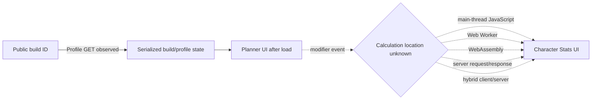

# Maxroll client-side calculation verification

## Outcome

- Architecture classification: **NOT_VERIFIED**.
- Operational blocker: **BLOCKED_NEED_MANUAL_EVIDENCE**.
- Client calculation status: **NOT_VERIFIED**.
- Server calculation status: **NOT_VERIFIED**.
- Hybrid calculation status: **NOT_VERIFIED**.
- Offline test: **NOT_RUN**.

No online modifier mutation, DevTools network observation, offline mutation, or
repeatability run was performed in this agent session. The result does not mean
that Maxroll lacks a client-side calculation engine. It means there is no new
admissible observation from which to classify the architecture.

## S1 — Baseline verification

Baseline checked at 2026-10-21T12:55:02+07:00.

- Current branch: `research/maxroll-calculation-p0`.
- Local HEAD: `c0e345e0430500b5c0b38fc85d8532348c3c4c24`.
- Remote research HEAD: `c0e345e0430500b5c0b38fc85d8532348c3c4c24`.
- Latest fetched `origin/master`:
  `9e1eec2838f73557853e2d017735b9d52533355e`.
- Working tree before this follow-up: clean.
- Historical evidence was read and left unchanged.

The existing evidence establishes:

1. P0-NET is **PASS**: both hosts resolved, TLS verification succeeded, and
   both HTTPS roots returned HTTP 200.
2. API-01 and API-02 are **PASS** for one publicly sourced build ID.
3. The Profile API returned serialized build/profile state. It did not return
   verified calculated Character Stats and must not be relabeled as a
   Calculation API.
4. Historical CALC-01 remained blocked/not verified before this follow-up.

Sources: `report.md`, `results.json`, `api-inventory.md`,
`evidence/network.txt`, and `evidence/profile-response.json`.

## S2 — Browser inspection setup

The access-policy check was repeated before attempting browser work. At
2026-10-21T12:55:02+07:00, `https://maxroll.gg/robots.txt` returned HTTP 200,
continued to disallow `/d4/planner/*` for generic agents, and stated that
automated retrieval needs written permission. The current
[Ziff Davis Terms of Use](https://www.ziffdavis.com/terms-of-use/) (effective
September 2026) also restrict automated retrieval and unauthorized reverse
engineering of web-based software.

This session exposes shell-driven automation, not a human-operated browser or
DevTools channel. Chrome/Chromium was not installed. Installing a browser would
not turn an automated agent session into the requested manual inspection and
would not remove the policy restriction. Therefore Playwright, browser
automation, planner retrieval, source inspection, and proprietary-code
extraction were not attempted.

Actual policy evidence is in
`evidence/client-calculation/policy-check.txt`. The required human procedure is
in `manual-test-instructions.md`.

## S3–S4 — Test results

| ID | Test | Status | Evidence |
|---|---|---|---|
| CALC-01A | Online modifier mutation | BLOCKED | `manual-test-instructions.md`; no runtime capture exists |
| CALC-01B | Network observation | BLOCKED | `evidence/client-calculation/policy-check.txt`; no DevTools capture exists |
| CALC-01C | Offline mutation | BLOCKED | `manual-test-instructions.md`; no offline capture exists |
| CALC-01D | Three-run repeatability | BLOCKED | `manual-test-instructions.md`; no A → B → C → A run exists |
| CALC-01E | Architecture classification | NOT_VERIFIED | This report and `client-calculation-results.json` |

Summary: **0 PASS / 0 FAIL / 4 BLOCKED / 0 NOT_RUN**, plus one
`NOT_VERIFIED` classification row. `BLOCKED` describes the missing manual test,
not the Maxroll architecture.

No Character Stat was tested. No screenshots, recordings, HAR files, WebSocket
frames, performance traces, or calculation response bodies were produced.

## Observed and unknown flow

Solid arrows are supported by the earlier profile evidence. Dashed arrows are
unverified candidates that require the manual test.

The profile response proves only the first data-loading edge. It does not prove
any of the candidate calculation edges.

## S5 — Architecture analysis

### 1. Where does calculation occur?

**NOT_VERIFIED.** There is no DevTools Network observation and no offline
mutation result.

### 2. What evidence proves it?

No evidence currently proves client-side, server-side, or hybrid calculation.
Existing profile JSON and successful connectivity are insufficient. The live
policy check proves only why agent-driven browser inspection stopped.

### 3. Which Character Stats were tested?

None.

### 4. Can verification continue for other stats?

Yes, after the first authorized manual flat-affix test is captured. Each
additional stat must retain its own input A/B/C, output values, network
observation, offline state, and repeatability result. A result for one stat must
not be generalized to all Character Stats.

### 5. Is an owner MAN test required?

Yes. A human operator must run the procedure in `manual-test-instructions.md`
after confirming that the intended inspection and evidence retention are
permitted. The sanitized results can then be committed without exposing
cookies, authorization headers, session identifiers, or proprietary code.

## Classification gates

- `CLIENT_CONFIRMED`: a novel modifier is recalculated correctly while offline,
  returns through A → B → C → A for three consistent runs, and no calculation
  response is required. The claim applies only to the tested stats.
- `SERVER_CONFIRMED`: a directly observed server request contains the relevant
  input and its response supplies the calculated output on which the UI update
  depends; offline mutation does not calculate.
- `HYBRID_CONFIRMED`: direct evidence shows material calculation work on both
  sides for the tested path.
- `NOT_VERIFIED`: evidence is missing, ambiguous, cached-only, or cannot exclude
  an alternative architecture.

Current classification remains **NOT_VERIFIED**, with high confidence that the
available evidence is insufficient and no confidence assigned to any specific
calculation architecture.

## Next action

| WHAT | WHO | WHY | HOW |
|---|---|---|---|
| Confirm inspection permission | Owner / legal or Maxroll contact | The current published policy does not authorize agent automation or reverse engineering | Confirm a narrow manual DevTools scope and evidence-retention rules; obtain written permission where required |
| Execute CALC-01A–D manually | Authorized human operator | Only direct UI/network/offline observations can classify the tested calculation path | Follow `manual-test-instructions.md` with a valid build and record three A → B → C → A runs |
| Sanitize and attach evidence | Human operator, reviewed by Dev F | Raw browser captures may contain credentials or unrelated personal data | Export only the request summary and cropped screenshots specified by the runbook; remove cookies, headers, tokens, user IDs, and full HAR content |
| Classify CALC-01E | Dev F | Avoid inferring architecture from absence of evidence | Validate timestamps, deltas, offline state, request correlation, and repeatability against the gates above |
