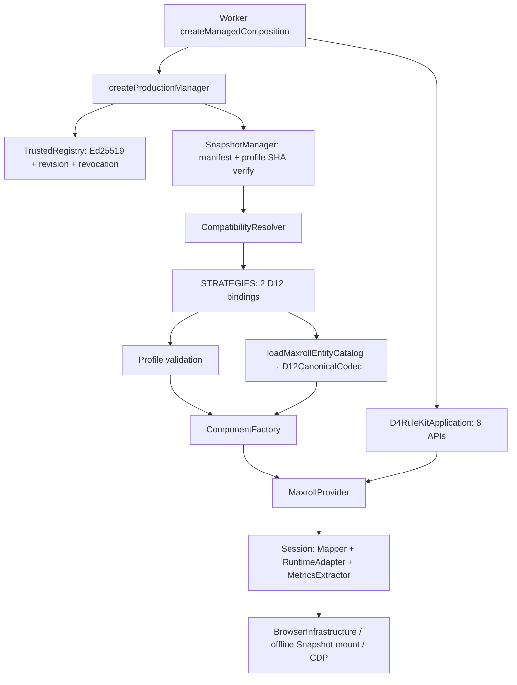

# Audit compatibility hiện tại — COMP-01

Audit source tại parent `fd87a98325b36f3fd8931af217155643484a5c87`, không dùng code S4–S7 làm base. Phạm vi đếm được công bố để tránh đếm mọi import/helper thành compatibility:

- **10 file Owner chỉ định**: ba file chứa knowledge D12 trực tiếp (`strategies`, `canonical-codec`, `real-profile`), bảy file guard/lifecycle/composition/validation.
- Mở rộng theo call path tới **22 implementation files** trong bảng dưới. Ngoài ba file trên có hai bảng option D12 và helper attestation D12: **sáu file phải chạm tối thiểu** để hỗ trợ một engine mới trên native path + attestation theo cách hiện tại, nếu schema/adapter/envelope còn tương thích.
- Con số sáu là change surface có điều kiện, không cam kết mọi engine tương lai đều sáu. Nó không gồm tests, fixture/profile/registry artifacts hoặc package policy; nếu runtime shape thay đổi sẽ nhiều hơn.

| File / exact source | Ownership / hardcode / phân loại |
|---|---|
| [utility/d4-rulekit/snapshot-management/src/resolver.js:7–23](https://github.com/Synclab-VN-dev/StreamOps/blob/fd87a98325b36f3fd8931af217155643484a5c87/utility/d4-rulekit/snapshot-management/src/resolver.js#L7-L23) | Shared guard: signed entry → strategy; codec/schema/provider/capability/asset/profile binding; không pin literal hoặc routing theo version. |
| [utility/d4-rulekit/snapshot-management/src/strategies.js:6–40](https://github.com/Synclab-VN-dev/StreamOps/blob/fd87a98325b36f3fd8931af217155643484a5c87/utility/d4-rulekit/snapshot-management/src/strategies.js#L6-L40) | Version-bound: hai strategy ID D12, provider/codec/schema catalog; D12 engine/catalog guard (23), exact canonical snapshot/manifest guard (35); chọn UI/native factory (28/38–40). |
| [utility/d4-rulekit/snapshot-management/src/manager.js:151–173](https://github.com/Synclab-VN-dev/StreamOps/blob/fd87a98325b36f3fd8931af217155643484a5c87/utility/d4-rulekit/snapshot-management/src/manager.js#L151-L173) | Shared guard: verify manifest/profile bytes, resolve; tính availability. Store/import/selection/generation ở 184–239; không sửa SNAP-05. |
| [utility/d4-rulekit/snapshot-management/src/trust.js:20–65](https://github.com/Synclab-VN-dev/StreamOps/blob/fd87a98325b36f3fd8931af217155643484a5c87/utility/d4-rulekit/snapshot-management/src/trust.js#L20-L65) | Shared trust: Ed25519, revision/expiry/revocation, exact ruleKitVersion và evidence class. Không pin engine hoặc formula. |
| [utility/d4-rulekit/providers/maxroll/src/canonical-codec.js:10–63](https://github.com/Synclab-VN-dev/StreamOps/blob/fd87a98325b36f3fd8931af217155643484a5c87/utility/d4-rulekit/providers/maxroll/src/canonical-codec.js#L10-L63) | Version-bound: CODEC_VERSION, snapshot ID/manifest/engine/catalog/patch; native state/profile/item field sets và class-mechanic mapping. |
| [utility/d4-rulekit/providers/maxroll/src/real-profile.js:12–99](https://github.com/Synclab-VN-dev/StreamOps/blob/fd87a98325b36f3fd8931af217155643484a5c87/utility/d4-rulekit/providers/maxroll/src/real-profile.js#L12-L99) | Version-bound: legacy DOjd và D12 engine path/SHA/provider/runtime versions, CDP locations, input/attestation/epoch expressions, selectors và option rule imports. |
| [utility/d4-rulekit/providers/maxroll/src/patch-profile.js:6–119](https://github.com/Synclab-VN-dev/StreamOps/blob/fd87a98325b36f3fd8931af217155643484a5c87/utility/d4-rulekit/providers/maxroll/src/patch-profile.js#L6-L119) | Generic schema/capability validation; runtimeKind if/else synthetic-vs-real, không version routing. Defaults Rogue/L50/Torment I là giới hạn fixture cũ, không coverage mọi build. |
| [utility/d4-rulekit/providers/maxroll/src/provider.js:34–118](https://github.com/Synclab-VN-dev/StreamOps/blob/fd87a98325b36f3fd8931af217155643484a5c87/utility/d4-rulekit/providers/maxroll/src/provider.js#L34-L118) | Generic exact verification trước acquire/mount/session; profile URL/hash/options binding. Không biết D12/Dfjs literal. |
| [utility/d4-rulekit/providers/maxroll/src/universal-component-factory.js:8–36](https://github.com/Synclab-VN-dev/StreamOps/blob/fd87a98325b36f3fd8931af217155643484a5c87/utility/d4-rulekit/providers/maxroll/src/universal-component-factory.js#L8-L36) | DI codec/planner identity → native adapter + mapper + extractor. Không pin literal; runtime family cố định. |
| [utility/d4planner/rulekit-worker/managed-snapshot-composition.js:10–34](https://github.com/Synclab-VN-dev/StreamOps/blob/fd87a98325b36f3fd8931af217155643484a5c87/utility/d4planner/rulekit-worker/managed-snapshot-composition.js#L10-L34) | Worker wiring: manager → signed entry/profile → strategy.createFactory/factory → Provider → Application. Không engine switch; nằm trong Rule Kit worker, không BE domain. |
| [utility/d4-rulekit/snapshot-management/src/index.js:6–35](https://github.com/Synclab-VN-dev/StreamOps/blob/fd87a98325b36f3fd8931af217155643484a5c87/utility/d4-rulekit/snapshot-management/src/index.js#L6-L35) | Production composition + upgradePreflight. Nạp STRATEGIES và anchors, không version resolution phía packaging. |
| [utility/d4-rulekit/providers/maxroll/src/component-factory.js:8–32](https://github.com/Synclab-VN-dev/StreamOps/blob/fd87a98325b36f3fd8931af217155643484a5c87/utility/d4-rulekit/providers/maxroll/src/component-factory.js#L8-L32) | Constructor injection RuntimeAdapter/BuildMapper/MetricsExtractor; runtime-family whitelist, không snapshot routing. |
| [utility/d4-rulekit/providers/maxroll/src/build-mapper.js:14–55](https://github.com/Synclab-VN-dev/StreamOps/blob/fd87a98325b36f3fd8931af217155643484a5c87/utility/d4-rulekit/providers/maxroll/src/build-mapper.js#L14-L55) | Narrow UI fixture business contract: Rogue/L50/Torment I, Helm/Runic Skullcap/Of Dampening; không phải universal codec. |
| [utility/d4-rulekit/providers/maxroll/src/universal-build-mapper.js:24–94](https://github.com/Synclab-VN-dev/StreamOps/blob/fd87a98325b36f3fd8931af217155643484a5c87/utility/d4-rulekit/providers/maxroll/src/universal-build-mapper.js#L24-L94) | Shared d4-build/v1 mapping/validation và change-type dispatch; if/else theo operation, không theo snapshot. |
| [utility/d4-rulekit/providers/maxroll/src/real-runtime-adapter.js:31–76](https://github.com/Synclab-VN-dev/StreamOps/blob/fd87a98325b36f3fd8931af217155643484a5c87/utility/d4-rulekit/providers/maxroll/src/real-runtime-adapter.js#L31-L76) | Profile-driven CDP location/expression/identity checks; UI operations ở 80–266; metric evaluation ở 273–278. Không engine pin literal. |
| [utility/d4-rulekit/providers/maxroll/src/native-state-runtime-adapter.js:41–98](https://github.com/Synclab-VN-dev/StreamOps/blob/fd87a98325b36f3fd8931af217155643484a5c87/utility/d4-rulekit/providers/maxroll/src/native-state-runtime-adapter.js#L41-L98) | Codec + attestation replay; helper createD12NativeLoaderMetadata hardwired ở 128–155 (envelope defaults), cần injection family contract nếu khác. |
| [utility/d4-rulekit/providers/maxroll/src/real-metrics-extractor.js:11–64](https://github.com/Synclab-VN-dev/StreamOps/blob/fd87a98325b36f3fd8931af217155643484a5c87/utility/d4-rulekit/providers/maxroll/src/real-metrics-extractor.js#L11-L64) | Shared metric uniqueness/completeness/finite values/provenance, profile catalog or runtime discovery. Không engine identity. |
| [utility/d4-rulekit/providers/maxroll/src/runtime-attestation.js:528–547](https://github.com/Synclab-VN-dev/StreamOps/blob/fd87a98325b36f3fd8931af217155643484a5c87/utility/d4-rulekit/providers/maxroll/src/runtime-attestation.js#L528-L547) | Profile-driven input/metric breakpoints. Readback/epoch 768–885; diagnostic source string l.context tại 636 là assumption phải tách; option semantics theo supplied rule objects 103–263. |
| [utility/d4-rulekit/providers/maxroll/src/d12-shared-options.js:3–60](https://github.com/Synclab-VN-dev/StreamOps/blob/fd87a98325b36f3fd8931af217155643484a5c87/utility/d4-rulekit/providers/maxroll/src/d12-shared-options.js#L3-L60) | Version-specific engine authority SHA, shared flags/types/bounds/labels, normalize percent-of-max. Không thể đổi authority sang Dfjs chỉ vì option IDs trùng. |
| [utility/d4-rulekit/providers/maxroll/src/d12-option-readback.js:3–41](https://github.com/Synclab-VN-dev/StreamOps/blob/fd87a98325b36f3fd8931af217155643484a5c87/utility/d4-rulekit/providers/maxroll/src/d12-option-readback.js#L3-L41) | Version-specific authority SHA + tám option semantic rules: trailing defaults, ignored flags, clamp-max, bound-control max. |
| [utility/d4-rulekit/providers/maxroll/src/fixture-attestation.js:282–306](https://github.com/Synclab-VN-dev/StreamOps/blob/fd87a98325b36f3fd8931af217155643484a5c87/utility/d4-rulekit/providers/maxroll/src/fixture-attestation.js#L282-L306) | Offline attestation helper hardwired D12 asset guard/profile factory. Validation/capture/cleanup generic ở 53–68, 215–258. |
| [utility/d4-rulekit/providers/maxroll/src/metric-catalog.js:3–38](https://github.com/Synclab-VN-dev/StreamOps/blob/fd87a98325b36f3fd8931af217155643484a5c87/utility/d4-rulekit/providers/maxroll/src/metric-catalog.js#L3-L38) | Narrow 50-row metric definition/IDs/labels/category catalog; không engine SHA literal. Không suy đủ Character Stats mọi class từ catalog này. |

## Các guard và hành vi không được đánh đồng

[utility/d4-rulekit/providers/maxroll/src/canonical-codec.js:424–496](https://github.com/Synclab-VN-dev/StreamOps/blob/fd87a98325b36f3fd8931af217155643484a5c87/utility/d4-rulekit/providers/maxroll/src/canonical-codec.js#L424-L496) xác minh expected manifest/catalog rồi tìm **exact D12 engine SHA** để lập option authority. Lỗi SNAPSHOT_MISMATCH là identity gate; không kiểm tra hoặc kết luận formula Dfjs sai.

[utility/d4-rulekit/providers/maxroll/src/canonical-codec.js:499–677](https://github.com/Synclab-VN-dev/StreamOps/blob/fd87a98325b36f3fd8931af217155643484a5c87/utility/d4-rulekit/providers/maxroll/src/canonical-codec.js#L499-L677) gọi provenance guards ở constructor/native import, gắn patch/CODEC_VERSION vào canonical result và tự tạo D12 runtime provenance trong runtimeStateToCanonical. Thay duy nhất engine SHA vẫn để lại snapshot/manifest/codec provenance cũ. Guards riêng tại [utility/d4-rulekit/providers/maxroll/src/canonical-codec.js:1080–1116](https://github.com/Synclab-VN-dev/StreamOps/blob/fd87a98325b36f3fd8931af217155643484a5c87/utility/d4-rulekit/providers/maxroll/src/canonical-codec.js#L1080-L1116).

[utility/d4-rulekit/providers/maxroll/src/canonical-codec.js:827–833](https://github.com/Synclab-VN-dev/StreamOps/blob/fd87a98325b36f3fd8931af217155643484a5c87/utility/d4-rulekit/providers/maxroll/src/canonical-codec.js#L827-L833) ràng patch; [utility/d4-rulekit/providers/maxroll/src/canonical-codec.js:988–1004](https://github.com/Synclab-VN-dev/StreamOps/blob/fd87a98325b36f3fd8931af217155643484a5c87/utility/d4-rulekit/providers/maxroll/src/canonical-codec.js#L988-L1004) dùng bảng shared option D12. Native-to-canonical item/profile mapping, reject-unknown, catalog entity legality, schema validation và canonical fingerprints là shared business mechanics có thể tái sử dụng **sau khi** native shape contract được kiểm chứng. Không bỏ reject-unknown hoặc tự đổi canonical schema để nhận engine mới.

[utility/d4-rulekit/providers/maxroll/src/real-profile.js:102–165](https://github.com/Synclab-VN-dev/StreamOps/blob/fd87a98325b36f3fd8931af217155643484a5c87/utility/d4-rulekit/providers/maxroll/src/real-profile.js#L102-L165) tạo capture expression, 50 expected metrics, labels/selectors, timeouts và cho config.realRuntime override. Đây là public runtime configuration trong source; không commit private generated profile. Design mới chỉ nhận execution-bearing fields từ bundled definition đã verify, không cho imported profile JSON tự chọn expression khác định nghĩa.

## Có switch/case theo version không?

Không thấy switch/case hoặc chuỗi if/else dispatch theo snapshot ID, engine filename/SHA trong 22-file slice. `strategies.js` là object map hai strategy D12, **registration thủ công**, chưa automatic per-version discovery. Hardcode nằm ở constants/guards/imports/factory declarations, nên chỉ tìm switch-case sẽ bỏ sót coupling.

- [utility/d4planner/rulekit-worker/worker.js:75–90](https://github.com/Synclab-VN-dev/StreamOps/blob/fd87a98325b36f3fd8931af217155643484a5c87/utility/d4planner/rulekit-worker/worker.js#L75-L90) switch theo tám Application **method**, không theo version.
- [utility/d4-rulekit/snapshot-management/src/manager.js:244–252](https://github.com/Synclab-VN-dev/StreamOps/blob/fd87a98325b36f3fd8931af217155643484a5c87/utility/d4-rulekit/snapshot-management/src/manager.js#L244-L252) dispatch Management method; [utility/d4-rulekit/providers/maxroll/src/universal-build-mapper.js:60–93](https://github.com/Synclab-VN-dev/StreamOps/blob/fd87a98325b36f3fd8931af217155643484a5c87/utility/d4-rulekit/providers/maxroll/src/universal-build-mapper.js#L60-L93) if/else theo change type; giữ nguyên.
- `patch-profile`/`component-factory` phân nhánh runtime family synthetic-vs-real, không snapshot ID.

## Hardcode lân cận, không nhầm với production compatibility resolver

| Source | Ý nghĩa |
|---|---|
| [utility/d4-rulekit/providers/maxroll/src/encrypted-fixture.js:10–21](https://github.com/Synclab-VN-dev/StreamOps/blob/fd87a98325b36f3fd8931af217155643484a5c87/utility/d4-rulekit/providers/maxroll/src/encrypted-fixture.js#L10-L21) | r01 snapshot/manifest/count/ciphertext/recipient defaults của encrypted fixture; giữ nguyên, descriptor explicit dùng cho r03. |
| [utility/d4-rulekit/providers/maxroll/src/snapshot-capturer.js:146–155](https://github.com/Synclab-VN-dev/StreamOps/blob/fd87a98325b36f3fd8931af217155643484a5c87/utility/d4-rulekit/providers/maxroll/src/snapshot-capturer.js#L146-L155) | Expected identity cũ để báo drift; capture không promote compatibility. Không sửa trong task này. |
| [utility/d4-rulekit/providers/maxroll/src/live-capture-orchestrator.js:19–29](https://github.com/Synclab-VN-dev/StreamOps/blob/fd87a98325b36f3fd8931af217155643484a5c87/utility/d4-rulekit/providers/maxroll/src/live-capture-orchestrator.js#L19-L29) | Online fixture policy/source constants; ngoài scope, không capture. |
| [utility/d4-rulekit/providers/maxroll/src/class-fixture-capture.js:375–377](https://github.com/Synclab-VN-dev/StreamOps/blob/fd87a98325b36f3fd8931af217155643484a5c87/utility/d4-rulekit/providers/maxroll/src/class-fixture-capture.js#L375-L377) | Capture/fixture tooling gắn D12; không mở lại online capture để hỗ trợ r03. |
| [utility/d4-rulekit/providers/maxroll/src/build-export.js:53–80](https://github.com/Synclab-VN-dev/StreamOps/blob/fd87a98325b36f3fd8931af217155643484a5c87/utility/d4-rulekit/providers/maxroll/src/build-export.js#L53-L80) | Validation export options/manifest của tool; không generic runtime registry. |
| [utility/d4-rulekit/providers/maxroll/src/index.js:9–16](https://github.com/Synclab-VN-dev/StreamOps/blob/fd87a98325b36f3fd8931af217155643484a5c87/utility/d4-rulekit/providers/maxroll/src/index.js#L9-L16) | Re-export legacy D12 codec symbols; cần giữ API facade khi di chuyển core. |

## Current call graph

Sự tồn tại signed registry/profile không đủ nếu implementation/codec guard chưa nhận binding. Ngược lại bundled implementation tồn tại cũng không thay signed approval. Không-snapshot vẫn UNAVAILABLE cho calculation.

## Current change surface cho Dfjs (không áp dụng cách này)

1. `canonical-codec.js`: binding/provenance/option-loader guards, tham số hóa native contract.
2. `real-profile.js`: thêm factory/coordinates/expressions/provider/runtime IDs.
3. `strategies.js`: thêm entry và factory mapping thủ công.
4. `d12-shared-options.js`: tách/rebind authority; giữ D12, không sửa pin chung.
5. `d12-option-readback.js`: tách/rebind authority và rule evidence.
6. `fixture-attestation.js`: helper không hardwire D12 khi kiểm chứng Dfjs.

**5 production definition files + 1 attestation helper = tối thiểu 6** với giả định adapter/mapper family dùng lại. Resolver/manager/trust/provider/worker có sẵn strategy.createFactory nên không bắt buộc thêm version branches. Các factory/core khác chỉ phải đổi nếu behavior thật khác. Thêm một file module mới theo cấu trúc hiện tại còn phải sửa package allowlist thủ công; do đó hiện chưa đạt COMP-00.

Packaging được kiểm tra read-only ở S7 HEAD `d09fdf60b02d35596f82b5d7aacd4c5e56644e9f`, **không** đưa commit S7 vào PR này:
- [build_release1_stage.py:87–90](https://github.com/Synclab-VN-dev/StreamOps/blob/d09fdf60b02d35596f82b5d7aacd4c5e56644e9f/utility/d4planner/tools/build_release1_stage.py#L87-L90) copy exact sourceAllowlist.
- [public-content-policy.json:3–76](https://github.com/Synclab-VN-dev/StreamOps/blob/d09fdf60b02d35596f82b5d7aacd4c5e56644e9f/utility/d4planner/release1/public-content-policy.json#L3-L76) liệt kê từng source path.
- [public_package.py:12–48](https://github.com/Synclab-VN-dev/StreamOps/blob/d09fdf60b02d35596f82b5d7aacd4c5e56644e9f/utility/d4planner/tools/public_package.py#L12-L48) policy và input digest. Cần một-time integration adapter; không được đổi thành recursive copy mọi .js từ user directory.

Historical source links above are pinned to the audited SHA. The current ownership
boundary moves composition into `application/src/runtime/` inside Rule Kit;
D4Planner ships only `src/d4planner/rulekit/worker.js` as its IPC adapter.
