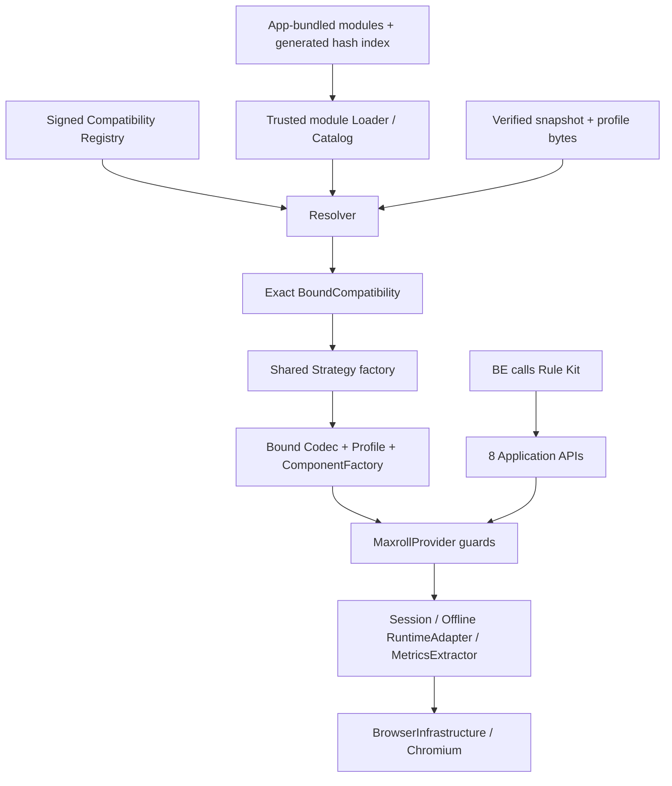

# Thiết kế đề xuất — chờ Owner duyệt

## Lựa chọn và giới hạn

Đề xuất **A có điều kiện: dùng chung native-state/CDP Strategy, codec core và ComponentFactory, inject immutable binding + version-specific observation/options contract**. Refactor coupling một lần, không retarget D12. Phase 1 cho thấy catalog và tập option IDs giống; hai hàm quan sát có cùng token shape sau alpha-renaming, tọa độ/biến đổi và fresh offline observation đọc được cùng shape. Đây là cơ sở để thử reuse core, **chưa phải** proof semantic equivalence hoặc Provider E2E.

| Tiêu chí | A — shared core, binding/config riêng | B — adaptation qua shared extension point |
|---|---|---|
| D12 backward compatibility | D12 entry giữ exact pins/config/provenance; legacy facade giữ tên exports | D12 giữ cùng entry/core; chỉ Dfjs dùng hook/family đã duyệt |
| Maintenance | Một version file, không nhân bản 1.126 dòng codec | Một version file chứa cấu hình/hook nhỏ; không copy cả codec; behavior mới có thể cần shared extension được Owner duyệt |
| Hiệu năng | Một lần discovery/index/resolve/verify; reuse resolved immutable factory theo generation | Có thể thêm bước transform/readback; phải đo so baseline, không tự đặt SLA |
| Độ phức tạp | Generic bound guards + declarative configuration | Thêm semantics/hook contract, output validation và test failure path |
| Rủi ro Character Stats | Cao nếu suy formula/readback từ same hash set hoặc nới guard; phải gate real attestation | Cao nếu adapter normalize bỏ qua input mismatch; không được normalize theo requested result |
| Snapshot thứ ba | Thêm 1 module nếu native family/extension points đủ | Thêm 1 module nếu dùng extension point đã tồn tại; nếu chưa đủ → design checkpoint mới |
| Evidence hiện có | Hỗ trợ feasibility của observation/config reuse; options/formula/full mapper còn UNVERIFIED | Chưa có evidence đòi một codec implementation thứ hai; không chọn B chỉ để thêm class |

Chọn A để triển khai sau approval. **Nếu Phase 2 chứng minh native mapping/option semantics không biểu diễn được bằng contract dưới đây, dừng integration Dfjs và trình mở rộng B**; không thêm switch/hash exception, không âm thầm tạo file thứ hai cho version. Không chọn A như một kết luận runtime compatible trước E2E.

## Target graph



Registry quyết định approval/revocation; bundled catalog quyết định implementation nào thực sự có. Không một phía tự thay thế phía kia. Content Version Detection và integrity vẫn riêng. BE/FE không nhận registry, không resolve profile, không load module.

## Tree sau one-time refactor

```text
snapshot-management/
  compatibility/
    contracts.js                 # definition schema + pure validation
    loader.js                    # verified bundle-root/index only
    catalog.js                   # exact indexes / ambiguity rejection
    build-index.js               # trusted tracked-source build discovery
    versions/
      maxroll-20261023.js         # D12: UI/native bindings + rules/profile data
      maxroll-20261027.js         # Dfjs: một entry point
      maxroll-next.js             # future example; KHÔNG thêm trước approval/evidence
  src/resolver.js                 # no version literals / routing
  src/strategies.js               # generic runtime-family factories, no version list
providers/maxroll/src/
  canonical-codec-core.js         # shared transformations + injected exact guards
  real-profile-core.js            # shared profile builder
  canonical-codec.js              # legacy D12 API facade, no duplicated codec body
  real-profile.js                 # legacy exports/facade, preserve legacy DOjd API
  d12-shared-options.js           # legacy named re-export of D12 definition data
  d12-option-readback.js          # legacy named re-export of D12 definition data
```

Legacy facade chỉ giữ đường gọi cũ và explicit D12 identity, không nằm trên future-version resolution path. Core không import facade/versions và không chứa snapshot ID/hash/filename. Version modules là leaf data/trusted hooks, không import codec facade, để tránh require cycles. D12 constants có một source of truth trong file D12; legacy exports đọc từ đó. DOjd legacy API giữ behavior cũ, không tự retarget hoặc coi là một snapshot mới được hỗ trợ.

## Contract một compatibility version file

Tên internal contract đề xuất: `d4-rulekit-compatibility-definition/v1`; không thêm/sửa tám Application APIs hay Snapshot Management methods. Registry envelope hiện hành vẫn dùng strategyId, codecVersion, providerVersion, schema, exact snapshot/manifest/engine/catalog, profile SHA và approval evidence. Không cần đổi signed Registry schema ở phương án này.

| Field | Quy tắc |
|---|---|
| definitionId/contractVersion | Unique, stable; duplicate hoặc unknown contract fail-closed |
| identity | Snapshot ID + manifest SHA + engine URL/SHA + catalog URL/SHA/version + game patch; không match chỉ theo filename/version |
| bindings[] | Signed strategyId/providerVersion/codecVersion/canonicalSchema combinations được module hỗ trợ; D12 có cả UI/native historical bindings |
| composition | IDs của shared runtime/codec/profile/factory family đã đóng gói, không JS path do user cung cấp |
| nativeContract | Field/shape/schema mapping, loader envelope, option enumeration grammar; reject unknown/lossy mapping |
| observation | Metrics/input locations, trusted read-only expressions, epoch source, selectors và limits |
| optionSemantics | Shared flags/types/bounds + explicit per-option readback/canonicalization rules + authority/evidence; không tự chuyển D12 authority thành Dfjs |
| capabilities | Metric/change-type/schema limits và fixture coverage đã chứng minh; thiếu proof không quảng cáo capability |
| evidenceRequirements | Hash/reference của independent evidence; file không tự cấp APPROVED/trust |
| hooks (optional) | Chỉ functions của bundled trusted module, nhận typed immutable data, output validated; không load code từ snapshot/user JSON |

Ví dụ **toàn bộ entry point Dfjs trong một file dự kiến**. Đây là pseudocode thiết kế trong Markdown, không phải module đã implement/validated. `pendingEvidence()` là tagged value làm runtime binding unavailable cho tới khi Phase 2 điền proof; không phải default bypass. Các rule tables nằm **trong cùng file này**, không tách thành `dfjs-options.js`/profile khác. Shared family functions không chứa snapshot identities.

```js
// compatibility/versions/maxroll-20261027.js — DESIGN, chưa activation
const { defineCompatibility, pendingEvidence } = require('../contracts');
module.exports = defineCompatibility({
  contractVersion: 'd4-rulekit-compatibility-definition/v1',
  definitionId: 'maxroll-20261027',
  identity: {
    snapshotId: 'maxroll-20261027T125615Z',
    manifestSha256: '823839198d5b7f5c4621664c44e62da50d50af86baed577ddc3ec22d04b67819',
    gamePatch: '3.2.1.73552',
    engine: {
      url: 'https://maxroll.gg/assets/export-DfjsImpl.js',
      sha256: 'f2ec59038e226775dd7d28ec6d4197bae65eb0d9871086016828edb6f00ad3d6'
    },
    catalog: {
      url: 'https://assets-ng.maxroll.gg/d4-tools/game/data.min.json?b8bc3970',
      sha256: '889facd9fa21a0a2baba3f8c28d53ac66b6e28a7514994f82ab8f00a3a5e1f93',
      version: '3.2.1.73552'
    }
  },
  bindings: [{
    strategyId: 'maxroll-native-DfjsImpl-v1',
    providerVersion: 'maxroll-provider/3.2.1.73552-DfjsImpl-candidate-v1',
    codecVersion: 'maxroll-native/3.2.1.73552-DfjsImpl-v1',
    canonicalSchemaVersion: 'd4-build/v1'
  }],
  composition: {
    strategyFamily: 'native-state-cdp/v1', codecFamily: 'maxroll-native-state/v1',
    profileFamily: 'maxroll-ui-cdp/v1', componentFactory: 'universal-native/v1'
  },
  nativeContract: {
    shapeFamily: 'maxroll-native-state/v1', unknownFields: 'REJECT',
    loaderEnvelope: 'maxroll-native-replay/v1',
    completenessEvidence: pendingEvidence('canonical round-trip + independent input attestation')
  },
  observation: {
    metrics: { lineNumber: 754, columnNumber: 226096,
      expression: '({id:u&&u.id,label:f,raw:_,values:u&&u.values})',
      epochExpression: 'l.context' },
    input: { lineNumber: 662, columnNumber: 42067,
      expression: '({profile:JSON.parse(JSON.stringify(T)),options:JSON.parse(JSON.stringify(D||{}))})',
      epochExpression: 'K.context' },
    resolvedState: { profileExpression: 'l.profile', itemsExpression: 'l.items',
      optionEntriesExpression: 'l.optionEntries' },
    selectors: { statsSections: 'div[class*="stats_StatSection"]', statsWidget: '.StatsTest' },
    interactionSelectors: pendingEvidence('all required profile navigation/editor selectors'),
    limits: { captureTimeoutMs: 30000, navigationTimeoutMs: 30000, interactionTimeoutMs: 10000 }
  },
  optionSemantics: {
    enumerationFamily: 'register-power-skill/v1',
    sharedDefinitions: pendingEvidence('full typed shared rules declared here'),
    readbackRules: pendingEvidence('full bounded option rules declared here')
  },
  capabilities: pendingEvidence('exact metricIds/changeTypes + narrow fixture coverage'),
  evidenceRequirements: {
    actualProviderE2E: pendingEvidence('COMP-04'),
    failClosedAndLifecycle: pendingEvidence('COMP-05/07')
  }
});
```

Không công bố profile/private build JSON. Manifest source URL và private replay planner identity đến từ verified manifest + signed profile binding; module kiểm tra declared family/shape, Resolver kiểm tra exact signed sourceUrl/profile SHA. Không cho caller thay expression/selector execution contract bằng user JSON: generated profile phải khớp version module về execution-bearing fields; các allowed data fields phải typed và bound vào signed profile SHA. Legacy D12 profile bytes không viết lại; giữ exact hash, kiểm tra explicit legacy contract rồi dùng same trusted runtime definition. Những profile cũ chứa override chưa thể xác minh tương đương phải fail-closed có lý do, không sửa hash để cho qua.

## Discovery / registration / security

1. **Build time:** chỉ duyệt `git ls-files` dưới đúng `compatibility/versions/`, immediate `*.js`, basename hợp lệ; sorted deterministic. Không scan SnapshotStore, node_modules, user path, untracked/generated fixtures. Reject symlink/special file/traversal, duplicate definition ID và exact binding ambiguity.
2. Build generator của Rule Kit validate definition shape/composition family, tạo `compatibility-index.json` (module relative path, SHA-256, metadata binding digest). Index là **generated artifact**, không một file registration phải sửa tay khi thêm N+1. Build ở trusted checkout; không chạy module lấy từ archive snapshot.
3. S7 nhận index/API output, đưa đúng modules vào package. Reuse public content allowlist/negative inspection để cấm blobs, private profiles, encrypted snapshot, keys; không đổi thành recursive include tùy ý. Index, shared sources và modules nằm trong installation integrity manifest. Thêm .js hợp lệ nhưng untracked không được bundle.
4. **Runtime:** Loader có installation code root cố định do Rule Kit xác định; không nhận override directory từ BE/FE/user config. Verify installer/release artifact integrity chain + index/module digests trước require. Không tự tin một JSON tự khai hash. Production code authenticity dựa vào trusted application artifact/distribution boundary hiện có; index checksum riêng không là trust anchor.
5. Chỉ require modules trong verified index và app root, realpath containment, no symlink. Extra file trên disk không được execute; missing/tampered listed module fail-closed. Không `eval`/Function/import URL để load definition. CDP read-only expressions đến từ trusted definition, chạy trong owned Chromium như cơ chế hiện có, không execute chúng trong Node hoặc lấy từ snapshot JSON.
6. Module là **trusted application code**, không giả Node `vm` là sandbox bảo mật. Process isolation của worker/Chromium và bounded APIs vẫn giữ. Arbitrary user JS không được nhận; nếu một runtime hook cần OS/network/path access mới → design checkpoint, không cấp ngầm.
7. Signed Registry → Resolver → exact tuple `(snapshotId,manifest,engine,catalog,providerVersion,codecVersion,schema,strategyId)` → **duy nhất một** bundled definition. Không ưu tiên filename mới nhất, highest version, fuzzy match hoặc fallback. Có thể nhiều snapshots dùng cùng strategy family; strategyId aliases không phải implementation switch.
8. Resolver tạo `BoundCompatibility` frozen, gắn entry/profile/module/binding digests + worker generation. Core lấy guards/provenance từ object này; không cho request tự truyền raw hash để widen. Revalidate entry revocation/integrity theo flow hiện có. Cache keyed bằng full binding/generation, không chỉ game patch.

Một compatibility file chỉ bổ sung **implementation support**. Signed Registry revision/profile package/compatibility evidence vẫn là artifacts riêng được sinh/verify qua pipeline, Owner approval cần thiết; không được tính chữ ký tự khai trong module là production approval. Yêu cầu “một file” là một authored compatibility source, **không** xóa các trust/distribution artifacts bắt buộc.

## Migration, lifetime và rollback

- Extract core từ codec/profile, giữ D12 exact identity và legacy exports bằng facade. So sánh D12 canonical/native round-trip, provenance, error codes, capabilities và Provider outputs trước/sau; không sửa expected để che khác biệt.
- D12 module chứa các UI/native bindings cũ và option rules nguyên nghĩa. Những earlier signed D12 bindings trong phạm vi cần giữ phải đưa vào explicit identity inventory; nếu phát hiện binding ngoài baseline đã chứng minh, báo review trước khi thu hẹp/bỏ nó.
- Current eight APIs, canonical schema, Management v1, Registry Ed25519/revision/revocation/distribution policy giữ nguyên. Internal loader/definition contract mới; không thêm network capture/check.
- Manager cung cấp internal `resolveActiveComposition()`/equivalent, worker chỉ inject returned factory. Read-only upgradePreflight dùng chính Resolver, không copy logic vào launcher/BE.
- One active snapshot/generation, switch yêu cầu generation mới; session/lease/cache/result binding cũ không đi qua boundary mới. Không sửa finding SNAP-05; test interactions nhưng không claim đã sửa failure path riêng.
- Application upgrade không rewrite snapshot/profile/selection DB. New binary không resolve được active binding → upgradePreflight fail-closed; giữ application cũ + state. App rollback chỉ hợp lệ nếu bản cũ hiểu binding và registry revision hiện tại; không rollback registry high-water hoặc DB để ép khởi động, không auto-switch snapshot.
- Production anchor tiếp tục chưa kích hoạt. Test key chỉ ISOLATED_TEST; included module + verified bytes không tự làm calculation READY.

## One-file proof và one-time change budget

**Dự kiến 25 production/build/policy files = 17 sửa + 8 thêm; 7 test files = 2 sửa + 5 thêm. Tổng plan 32 files (không tính docs và generated/private evidence).** Đây là kế hoạch được trình duyệt, không số file đã implement.

| One-time sửa (14 tại Rule Kit/worker) | Nội dung |
|---|---|
| `snapshot-management/src/resolver.js` | Resolve exact catalog definition rồi factories; không version literals |
| `snapshot-management/src/strategies.js` | Shared family implementations; bỏ manual per-version registry |
| `snapshot-management/src/manager.js` | Internal bound-composition handoff, preserve verification/selection semantics |
| `snapshot-management/src/index.js` | Trusted loader/catalog bootstrapping |
| `providers/maxroll/src/canonical-codec.js` | Legacy facade gọi generic core + D12 definition; không duplicate body |
| `providers/maxroll/src/real-profile.js` | Legacy facade/API; core/profile data tách; legacy DOjd giữ nguyên |
| `providers/maxroll/src/d12-shared-options.js` | Legacy named re-export từ D12 entry |
| `providers/maxroll/src/d12-option-readback.js` | Legacy named re-export từ D12 entry |
| `providers/maxroll/src/native-state-runtime-adapter.js` | Inject validated native loader envelope; legacy helper facade |
| `providers/maxroll/src/universal-component-factory.js` | Bound codec/runtime contract injection |
| `providers/maxroll/src/runtime-attestation.js` | Generic epoch provenance label/contract, preserve evidence validation |
| `providers/maxroll/src/fixture-attestation.js` | Offline helper dùng resolved contract, legacy D12 default giữ nguyên |
| `providers/maxroll/src/index.d.ts` | Types cho generic/internal contracts; không đổi eight APIs |
| `utility/d4planner/rulekit-worker/managed-snapshot-composition.js` | Nhận bound factory; không tự đọc/resolve compatibility |

8 file thêm chính là `contracts.js`, `loader.js`, `catalog.js`, `build-index.js`, hai files trong `versions/`, `canonical-codec-core.js`, `real-profile-core.js` trong tree ở trên.

3 file S7 one-time: `utility/d4planner/tools/build_release1_stage.py`, `tools/public_package.py`, `release1/public-content-policy.json`. Chúng chỉ tích hợp trusted build index + bounded packaging rule, không chứa Resolver. **Owning PR #150**: hiện không nằm trong branch parent #146. Không đưa sibling commits vào PR #154. Sau approval, thay đổi S7 phải qua integration ordering được Owner cho phép; hiện chỉ thiết kế/read-only audit. Không thể claim installable one-file support nếu bỏ qua phần S7 này.

| Tình huống | Authored compatibility files | Shared core / other files per version |
|---|---:|---|
| D12 sau refactor | 1 D12 file (hai bindings UI/native trong cùng entry) | 0; guards/config/provenance giữ nghĩa; Phase 2 phải chứng minh |
| Dfjs trong refactor lần đầu | 1 Dfjs file | One-time shared refactor ở bảng trên; chưa implementation PASS |
| N+1, family/extension points đã có | **1 file mới** `versions/<version>.js` | **0** resolver/strategies/codec/profile/worker/BE/FE/handwritten registration/handwritten package allowlist |
| Native behavior/schema chưa biểu diễn được | Chưa đủ điều kiện one-file | **DESIGN_BLOCKED** cho version đó; Owner duyệt shared extension trước, không lách bằng hidden branches |

Sau one-time refactor: `resolver.js` **không sửa**; `strategies.js` **không sửa**; `canonical-codec.js` **không sửa**; `real-profile.js` **không sửa**; BE/FE **không sửa**; package index/manifest tự regenerate. Thêm snapshot N+1 yêu cầu sửa **1 authored file**, shared=0. Synthetic C test phải kiểm `git diff --name-only`/hash core và import graph, không chỉ đếm danh sách registration.

## Owner decisions cần chốt tại checkpoint này

1. Duyệt phương án A có điều kiện, bounded contracts/extension points, automatic trusted module catalog và legacy facades; B chỉ mở khi evidence đòi shared behavior mới.
2. Duyệt one-time plan 25 code/build/policy + 7 test files, giữ public API/trust semantics; bất kỳ breaking contract mới phải trình riêng.
3. Duyệt dependency/ownership packaging: ba file S7 ở #150 cần integration ordering hợp lệ sau Rule Kit. **Không** dùng design approval làm quyền tự merge/rebase true stack hiện hữu; Owner cần chỉ định lúc tích hợp #154 vào lineage trước khi thực thi thay đổi S7 phụ thuộc.

Phase 1 dừng ở đây. Chưa có approval COMP-02, chưa triển khai loader/codec/profile cho production.
