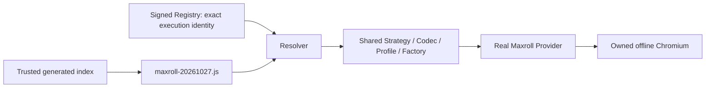

# Dfjs r03 — một authored compatibility module, test-only

PR con base trực tiếp #155. Production delta chỉ là `compatibility/versions/maxroll-20261027.js`; generated index, tests và tài liệu là các artifacts được Owner cho phép. Không sửa Factory/Resolver/shared codec trong PR con. Không sửa #147–#150.

## Identity và phạm vi

- Snapshot `maxroll-20261027T125615Z`; manifest SHA-256 `823839198d5b7f5c4621664c44e62da50d50af86baed577ddc3ec22d04b67819`.
- Engine `export-DfjsImpl.js`, SHA-256 `f2ec59038e226775dd7d28ec6d4197bae65eb0d9871086016828edb6f00ad3d6`.
- Catalog `3.2.1.73552`, SHA-256 `889facd9fa21a0a2baba3f8c28d53ac66b6e28a7514994f82ab8f00a3a5e1f93`.
- Native/canonical family only. Không đăng ký legacy UI strategy chưa kiểm chứng. Production trust/activation/approval không được cấp bởi module này.



## Before → After / root cause

| Before | After / evidence |
|---|---|
| D12 pins chặn engine mới | Dfjs module có exact pins riêng; D12 module không đổi |
| Input expression N/T, coordinates D12 | Dfjs T/D; metrics CDP 754:226096, input 662:42067, zero-based; verified actual runtime |
| Shared observer yêu cầu mọi item input có trong calculation context | #155 thêm generic opt-in projection; Dfjs khai báo raw item store F, input engine item-data q.items, nhóm Charm slots 21–26. Không bỏ input hoặc dùng requested values bù readback |
| Chưa có expected độc lập cho r03 | Source-only offline observation từ original recorded response, không Provider/Canonical Codec output, tạo hai immutable oracle vectors trước Provider E2E |
| Guard mismatch chưa chứng minh semantics | Actual Provider + managed worker đủ 8 APIs, 50 raw metrics mỗi oracle, 35 metrics đổi giữa hai variants; options exact, cleanup verified |

Engine item-data xét Horadric Seal charm capacity. Variant đầu giữ 18 item references trong input nhưng chỉ 15 calculation items (omit 24–26); variant sau dùng đủ 18. Module không hardcode capacity=3: capacity selection do pinned runtime thực hiện và được quan sát ở input frame. Shared mechanism kiểm raw input đầy đủ, exact active projection cùng epoch, không chấp nhận value bị thay/slot lạ/omission ngoài declared group. Canonical round-trip giữ cả inactive input items, projection metadata phân biệt tập được tính. Fail-first source observation thiếu extension đã FAIL `READBACK_MISMATCH`; sửa shared mechanism tại #155 rồi rebase con, không nới equality toàn cục hoặc thay fixture expected.

## Oracle provenance và limits

`tests/real/source-oracle.js` verify toàn snapshot; export hai visible profiles index 2/3 từ response có sẵn trong r03. Tên file `rogue-midgame`/`rogue-endgame` là alias để tái dùng harness, không claim tên source profile. Dùng `runCapture(mode:'source')`, fresh Chromium offline-strict, không response override, không canonical mapper/Provider. Chỉ catalog parser cung cấp option authority. Input/phase/engine identity, zero egress và owned cleanup phải PASS. Sau đó Provider mới chạy để so full raw vectors; không lấy output đang test làm expected.

`option-structure-audit.js` xác minh tám registered rule groups cùng cấu trúc AST sau mask local identifiers và ba nhóm shared flags/params/options tương ứng. Property identifiers/literals được giữ khi so. Đây là supporting static evidence, **không proof toàn bộ semantics/formulas**. Actual dynamic acceptance giới hạn hai recorded Rogue variants, metrics/options đã quan sát; không claim mọi class/build, live capture, DPS/Torment product acceptance hoặc production compatibility approval.

## Automation

Từ repo root, provision npm dependencies theo lockfiles; dùng private snapshot root và Chromium đã pin, không network capture:

```bash
node utility/d4-rulekit/snapshot-management/compatibility/build-index.js
node --test utility/d4-rulekit/snapshot-management/tests/*.test.js
# Env: COMPATIBILITY_TEST_DEFINITION=maxroll-20261027,
# MAXROLL_AUTHORIZED_SNAPSHOT_ROOT, MAXROLL_B0_FIXTURE_ROOT (new private oracle dir),
# BROWSER_INFRA_CHROMIUM_PATH.
node utility/d4-rulekit/snapshot-management/tests/real/source-oracle.js
# Oracle files phải tồn tại, không sửa expected sau Provider result.
node --test utility/d4-rulekit/snapshot-management/tests/real/dfjs-framework.test.js
# D12 regression: unset COMPATIBILITY_TEST_DEFINITION, dùng existing D12 fixture dir.
node --test utility/d4-rulekit/snapshot-management/tests/real/d12-framework.test.js
# Static audit: env COMPATIBILITY_AUDIT_OUTPUT là private output JSON path.
node utility/d4-rulekit/snapshot-management/tests/real/option-structure-audit.js
```

Managed worker assertions: all eight method names thực sự được gọi, independent vector comparison, preview nonmutating/revision 0, commit revision 1 + expected changed vector, stale commit rejected, reset revision 2 + baseline fingerprint/vector, closed-session rejection, owned worker exit 0/browser cleanup. Binding unit negatives là synthetic manifest containers, tách khỏi real provider evidence. Generated index changes execution identity nên test registry được ký mới bằng ephemeral ISOLATED_TEST key; không reuse old signed approval hay provision production anchor.

| Acceptance | Expected/actual | Status |
|---|---|---|
| DFJS-01 | Child Draft base exact #155, parent ancestor | Verified ở final handoff |
| DFJS-02 | Một authored version module, no shared edits/manual Factory registration | PASS source diff |
| DFJS-03 | D12 real managed-worker/API regression giữ behavior | LOCAL_PASS trong existing fixture scope |
| DFJS-04 | r03 offline Provider + eight APIs + independent oracle/cleanup | LOCAL_PASS trong hai Rogue variants |
| DFJS-05 | Exact engine/catalog/manifest/profile/codec, unknown/revoked/forged/stale approval guards | LOCAL_PASS; production trust NOT_ACTIVATED |
| DFJS-06 | Exact SHAs, test logs/durations và oracle provenance | Final handoff, CI_NOT_CHECKED |

Private artifacts không commit/upload. S7 packaging, production trust/signing/distribution, merge/release là checkpoint riêng. Không capture/release lại snapshot, không Windows A/Actions. Cả hai PR giữ Draft để review chung theo Owner directive 28/10.
