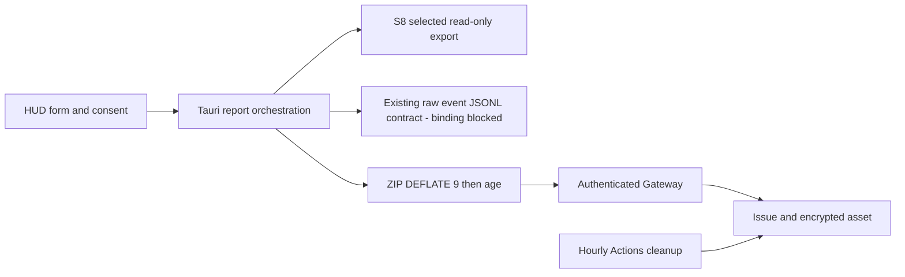

# S9 — Report Issue (#161)

Parent: PR #160 / `951f86b3fdde6e39edbefe1200a52ebd3828b45d`.
Source implementation only. No production deployment, GitHub Issue/Release creation,
asset upload, recipient approval or visual approval is implied.

## Independent engineering assessment (before implementation)

| Concern | Assessment / decision | Evidence / minimal solution |
|---|---|---|
| Another logging framework | DISAGREE / EXISTING_COVERAGE_SUFFICIENT | S8 `runtime-logging::export` already filters JSONL and bounds reads. Add selected-source variant; retain old three-file export semantics. |
| React accessing private files | AGREE / FIX_REQUIRED | Existing `App.tsx` has no diagnostic commands. React passes booleans/form only; native derives DataRoot from launcher-controlled S8 session. |
| Raw event attachment clarification (31 October) | AGREE / FIX_REQUIRED | Only FE/BE/Rule Kit logs and optional raw event JSONL. Remove DB backup/helper and projector attachment. Existing `cli.command_logs(raw=True)` selects capture state; packaged HUD has no verified session binding. Fourth source remains explicitly UNAVAILABLE, pending integration approval. |
| Encryption needs a CLI/global age | DISAGREE / NEEDS_DIFFERENT_SOLUTION | Linked Rust age implementation and ZIP avoid a user toolchain. X25519 recipient supplied by operator configuration, no default key. |
| Blind GitHub POST retry | AGREE / FIX_REQUIRED | GitHub Issue create is not an idempotent POST. Persist CREATING before POST, reconcile bot marker; if outcome cannot be proven, stop at CREATE_OUTCOME_UNCERTAIN, never recreate. |
| Universal hosting/auth choice | PARTIALLY_AGREE / NEEDS_DIFFERENT_SOLUTION | Hosting, issuer/audience and App custody not approved. Hosting-neutral WSGI service with mandatory authenticated-subject/token callbacks; no insecure default implementation or deployment. |
| Shared prerelease always mutable | DISAGREE / FIX_REQUIRED | API exposes `immutable`; exact release ID/tag/name/prerelease/draft/immutability must pass before upload or cleanup. Never create a release or change settings. |
| Cleanup can be atomic with reopen | DISAGREE / NEEDS_DIFFERENT_SOLUTION | REST state reads and DELETE are separate requests. Refetch issue/closed_at/mapping/release/asset; document remaining TOCTOU window, never promise atomicity. |
| Candidate equals Golden | DISAGREE / EXISTING_COVERAGE_SUFFICIENT | MagicPath component `458765764401446912`, candidate `467075409201213440` read through production integration. Visual/merge BLOCKED until approved independent Golden. |

## Architecture

- `report-issue/`: native crate, selected preview, private bounded ZIP, age, transport.
- `src-tauri/src/issue_report.rs`: async blocking-task dispatch; no React-provided paths.
- `src/ReportIssue.tsx`: tab state, exact preview, consent, retry, real URL.
- No DB export helper or backup code. Raw event collection does not launch capture or query DB.
- `d4planner-report-gateway/`: host-neutral service and cleanup; no client App credential.
- Rule Kit, snapshot trust, S8 quotas and public Setup distribution are unchanged.

## Local contract and provisioning

Native commands: `collect_issue_report(selection)`, `submit_issue_report(reportId,
description, consent)`, `resume_issue_report(reportId)`, `cancel_issue_report()`.
All filenames derive from fixed source allowlists. No SQLite/path access from React.

Launcher-controlled environment:

- S8 `D4_LOG_DIR` / `D4_LOG_RUN_ID`, packaged `D4PLANNER_BACKEND_PYTHON`.
- Optional D4Planner Event Log: currently UNAVAILABLE until a verified existing raw JSONL source/session binding is approved. No capture environment variables or guessed legacy paths.
- `D4PLANNER_REPORT_CONFIG`: absolute owner-controlled JSON with `recipient`
  (approved age X25519 public recipient), `gateway` (HTTPS URL), `maxBytes`.
- `D4PLANNER_REPORT_ACCESS_TOKEN`: short-lived **user** access credential, supplied by
  approved auth integration. Never a GitHub token; not written to drafts/logs/archives.

No production defaults are supplied. Recipient custody, max upload bytes, authentication
provider and Gateway hosting require Owner decisions. Missing config fails explicitly;
collection remains usable offline. Native bridge does not expose secrets to React.

Manifest `d4planner-issue-report/v1`: reportId, runId, product/source version from S8,
timestamp, consent scope, exact files/bytes/SHA-256, generations/drop/trim information
where present, BEST_EFFORT/EMPTY completeness. D4 files carry capture session ID.
Only selected sources are read; unavailable sources remain explicit in the preview.
S8 live snapshots are best effort, never mislabeled COMPLETE. No sources still produces
an encrypted manifest-only report, not fabricated logs.

Safety ceilings (not a production upload approval): 64 MB total export/ciphertext,
Strict four-source allowlist, complete valid raw JSONL records only,
60-second HTTP timeout, 64 KB Gateway response. ZIP DEFLATE level 9. No redirect.
Private staging is owner-only; at most three retained sealed reports, no unlimited
report accumulation. Files are compressed/encrypted locally. Ciphertext and private
form draft survive process exit for retry; access tokens do not. Cancel/success removes
owned staging. Interrupted unsealed reports are reclaimed on next collection under
ownership marker/lock; foreign paths and locked reports are retained. Explicit cancel
is destructive to the local pending draft only, not to remote Issues/assets.

A sealed report's recipient and form become immutable once submission is attempted;
retry uses the same ciphertext/reportId and description. Editing requires recollection
with a new reportId. This may leave a remote LOG_UPLOAD_PENDING Issue; it is not silently
deleted. No orphan asset deletion or invented resolution of ambiguous remote state.

## Gateway contract and operations

`PUT /reports/{uuid}`: JSON `{description, artifact:{reportId,bytes,sha256}}`.
`POST /reports/{uuid}/asset`: binary age ciphertext. Bearer user authentication mandatory.
Response contains verified Issue URL, reportId, status and mapping. Per-subject isolation;
5 new reports/hour and 60 requests/hour, serialized durable SQLite state.

Host supplies a verifier that checks token signature, issuer, audience, expiry and
revocation as required by the approved auth model. `GitHub(token_callback)` receives
only server-side App installation tokens from the host's custody mechanism. Request
limits must also be configured on the serving reverse proxy; WSGI has no network listener.
No multi-replica databases, stateless retry or static client credentials are supported.

Exact numeric dedicated release ID and bot user ID must be provisioned. Release must
already exist, named `D4Planner Bug Report Logs`, tag `d4planner-bug-report-logs`, mutable,
prerelease, non-draft and not latest (provisioning check). Service does not create it.
App requires this repository only, Issues write and Contents write. Cleanup requires
Contents write/Issues read; repository variables bind release/bot IDs.

State: PREPARED → CREATING → UPLOAD_PENDING → COMPLETE. Before uncertain create, durable
intent is committed. Recovery fully enumerates bot-owned Issue markers; absent/ambiguous
result blocks instead of another POST. Upload reconciles exact unique asset name,
GitHub digest, size, uploader and state. Mapping is versioned bot-owned comment; asset
and Issue IDs, reportId, release/tag, SHA/size must all agree. Retry does not republish an
expired COMPLETE report. Enumeration stops safely at its bounded page budget.

No sensitive logger output is emitted by the Gateway. User form text is intentionally
public and requires explicit review. An age structural check cannot cryptographically
prove a malicious authenticated user's bytes are encrypted; native encryption is the
client trust boundary. Abuse controls and authentication remain production host gates.

## Cleanup

Hourly `17 * * * *`; manual defaults dry-run. No overlapping workflow runs. Exact
release preflight precedes any mutation. Only bot-owned mapping for a currently CLOSED
Issue strictly older than 24 hours qualifies. Refetch mapping, release, asset and
Issue/closed_at before DELETE. OPEN, REOPEN, boundary==24h, foreign, invalid and orphan
assets are retained. No Issue/release deletion. HTTP failure fails closed; next scheduled
run is the bounded retry, not an unbounded in-process loop. DELETE 404 is idempotent.
Reopen after deletion does not restore evidence. A reopen in the final REST race window
cannot be prevented atomically; eligibility is based on the last successful refetch.

## Review/production gates

Code/local tests do not grant deployment/public upload permission. Owner must decide:

1. Gateway host, TLS endpoint, authenticated user model, App installation/custody.
2. Public age recipient/custody and upload byte limit.
3. Dedicated prerelease creation and private isolated GitHub integration approval.
4. Approved MagicPath Golden; candidate reference is not visual acceptance.

No production keys, raw user logs, snapshot, DB, screenshot or credentials are committed.

## Raw event source checkpoint (Owner correction, 31 October 2026)

`runtime/events/store.py::EventStore.create` records `events.jsonl` as a legacy
path; current events are emitted through the existing event store. `cli.py::command_logs`
with raw=True emits JSONL for the session in `_state(paths)`, with a legacy fallback.
It has no explicit requested-session argument; the packaged HUD does not currently
supply a verified capture RuntimePaths/session mapping. Calling it against a guessed
DataRoot or exporting the most recent session is not an acceptable substitute.

Minimal proposed integration: bind the existing capture root and requested session
at the composition boundary; reuse `logs --raw` with an explicit session guard and
bounded output, without new capture/storage or direct report-side DB access. Owner
approval is required before extending that existing CLI contract. Until then the
fourth source is selectable with separate raw-content consent but preview reports
UNAVAILABLE. Three S8 sources, encryption, Gateway and cleanup remain independent.
RPT-02 raw-source production integration is BLOCKED; synthetic JSONL validation is
not evidence that packaged capture is connected. Old sealed reports containing any
DB, WAL, projector or separate speech file are rejected on resume/encryption.
