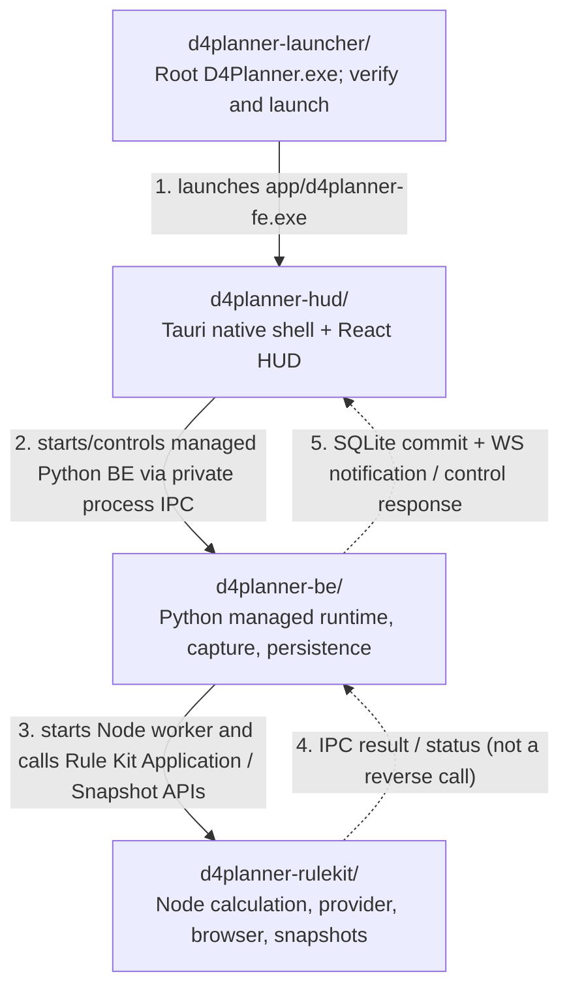

# D4Planner — Production folder architecture (Level 1)

> **Source of truth:** current `master` implementation; diagram scopes only **direct child production folders** of `utility/d4planner/`. `d4planner` is a project, not a fifth runtime component.

## Production folder relationships

## Responsibilities and verified boundaries

| Direct child | Owns | Detailed diagram |
| --- | --- | --- |
| [`d4planner-launcher/`](d4planner-launcher/) | Native root bootstrap, installed-payload integrity, owned application launch and cleanup. Not a business domain. | No additional diagram at this three-level scope: source has only the direct `src/` folder. |
| [`d4planner-hud/`](d4planner-hud/architecture.md) | React overlay and Tauri shell; owns the managed BE process, reads committed **public** HUD SQLite projection read-only and receives lightweight WS notifications. | [HUD architecture](d4planner-hud/architecture.md) |
| [`d4planner-be/`](d4planner-be/architecture.md) | Capture and event processing, durable data/Target selection, assessment, managed service, Rule Kit worker lifecycle, authenticated notification/control boundary. | [BE architecture](d4planner-be/architecture.md) |
| [`d4planner-rulekit/`](d4planner-rulekit/architecture.md) | Calculation Application, Maxroll provider, browser runtime and snapshot compatibility/trust/selection. | [Rule Kit architecture](d4planner-rulekit/architecture.md) |

**Runtime details that must not be mistaken for new folder edges:**
- The BE starts a Node process with the internal Rule Kit bootstrap (`d4planner-rulekit/application/src/runtime/bootstrap.js`) and its BE-owned IPC adapter (`d4planner-be/src/d4planner/rulekit/worker.js`). This does **not** mean HUD calls Rule Kit directly.
- BE commits the public HUD SQLite projection; Tauri native reads that projection read-only. WebSocket notifies revision/availability, **not** the full HUD model. No direct FE → Rule Kit API.
- Root `D4Planner.exe`, `app/d4planner-fe.exe`, `backend/`, and `utility/d4-rulekit/` are **installed paths**, not sibling source folders.
- The Launcher exists at source level as a runtime bootstrap component, although the three business domains are HUD, BE and Rule Kit.

## Scope and conventions

- **Maximum depth: 3**, counting `d4planner/` as level 1. This file shows level-2 child folders only; linked component documents show their level-3 direct children only.
- Include only folders participating in the shipped/installed runtime or its direct runtime contracts. Exclude CI, tests, fixtures, documentation-only scripts, build tooling and standalone diagnostic/test runners.
- Solid edges represent actual runtime invocation or control. Dashed edges represent returned output/data/notifications, **not** circular calls. Numbers refer to the representative startup/data flow, not to every possible request.
- This document records **as-implemented** behavior, not a proposed refactor. Application packaging and private snapshot distribution/approval are unchanged.

### Architecture-rule discrepancy (documentation only)

The separate OpenStream architecture rule currently says HUD must not read BE SQLite. The implemented DB-first contract instead allows **Tauri to read the public SQLite projection read-only** (see `d4planner-hud/src-tauri/src/hud_reader.rs`, `d4planner-be/src/d4planner/release1/persistence.py` and the root README). The documentation follows the actual source and does **not** approve any rule/contract change.
