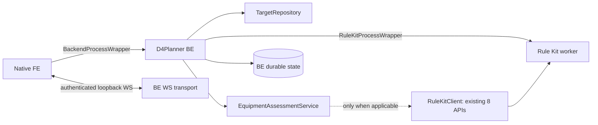
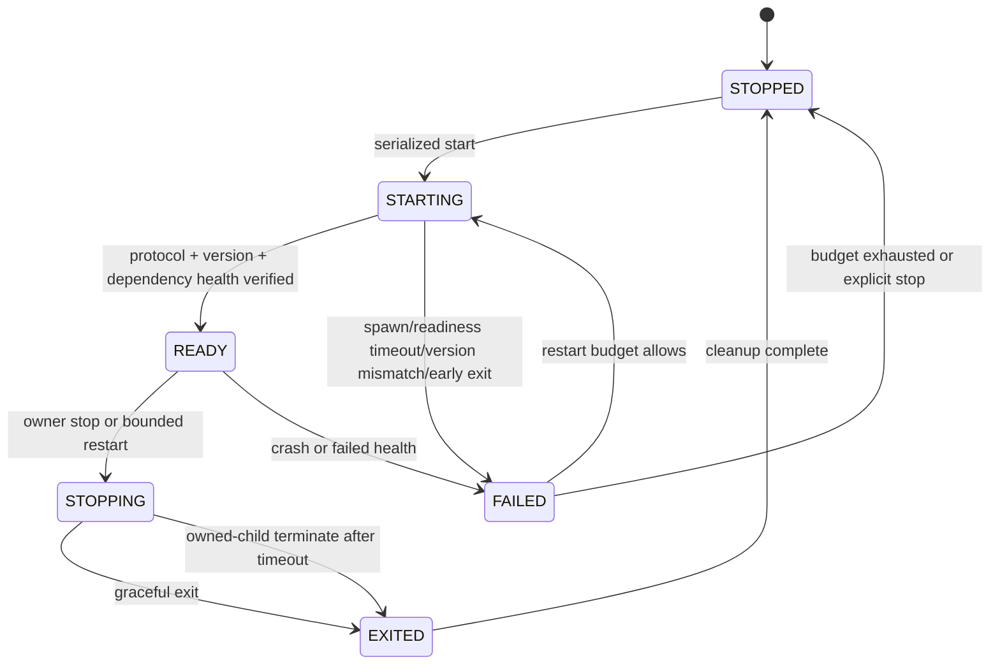
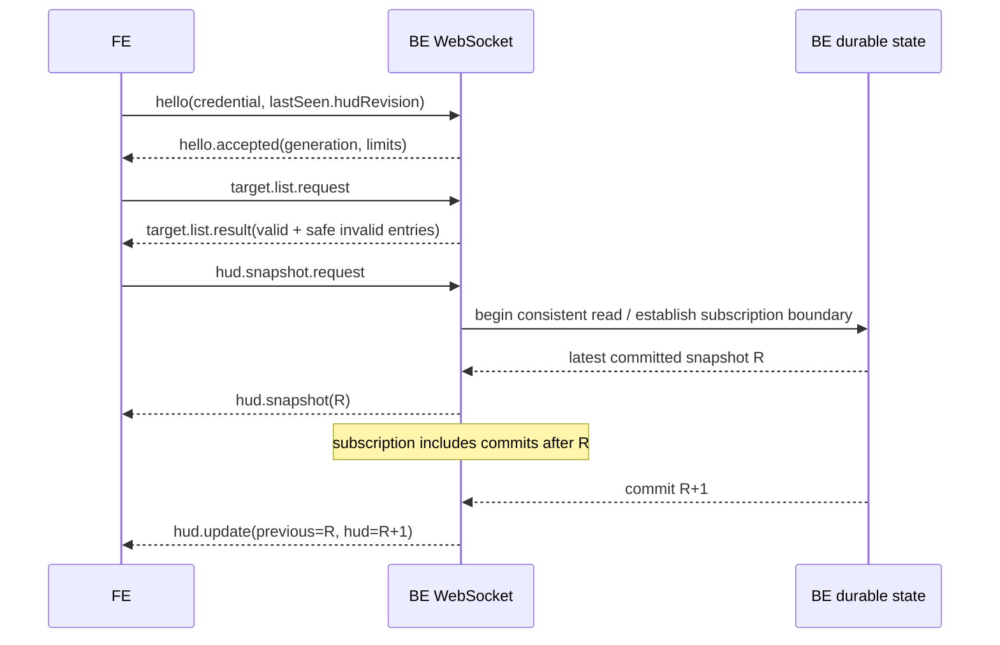

# ADR-001: Release 1 integration boundaries and lifecycle

- Status: `CANDIDATE`, pending only decisions recorded in `decisions-and-dependencies.md`
- Contract: `d4planner-r1-contract/1.0.0-candidate.1`
- Scope baseline: `R1-EQUIPMENT-20261025`
- References: Epic #137, S1 #138

## Decision

The native FE owns one managed Backend child. The Backend owns one managed Rule
Kit worker child. Each owner uses its own Template Method wrapper and an injected
process driver. Wrappers own lifecycle only. Target storage, assessment,
persistence, WebSocket transport, Rule Kit business calls, and rendering remain
separate ports in `interfaces.ts`.



The Release 1 equipment score does not require full Character Stats or a Rule
Kit evaluation. Skills, Paragon, Charms, Torment, DPS, inventory/stash search,
and Workspace are not scoring inputs. This does not remove the S3 lifecycle and
compatibility boundary.

## Lifecycle state machine



`spawn()` success is not READY. READY requires an application handshake whose
protocol version, configuration fingerprint, owner/child identities, generation,
and health checks match the launch specification. Concurrent `start()` calls
join the same in-flight start; they never spawn multiple children. `stop()` is
idempotent and suppresses restarts. Hide/collapse changes FE presentation only;
it never means exit.

### Ownership, exit, crash, and parent death

- Every process receives unguessable owner/child instance IDs and a monotonic
  generation. Only the recorded PID plus identity may be stopped. Never kill by
  `python`, `node`, or `chrome` name and never affect Diablo IV, Steam, OBS, or
  NVDA as a group.
- The owner first requests protocol-level shutdown, waits the configured graceful
  timeout, then may terminate only its verified child. Cleanup waits for exit,
  closes handles, revokes credentials, and invalidates generation-bound state.
- Unexpected exit emits `CRASHED`; restart uses bounded attempts in a rolling
  window with jitter/backoff. Exact budget values are deployment config, not an
  unapproved product default. Budget exhaustion reports FAILED.
- Parent-death containment must use a real OS ownership mechanism suitable for
  packaged Windows (for example a job object or inherited parent-death channel).
  A detached CLI or Scheduled Task is not a managed child. A child that detects
  parent loss stops accepting work, closes sessions, and exits within its bound.
- A worker restart changes `workerGeneration`; all old Rule Kit contexts,
  sessions, leases, preview tokens, and queued work are invalid and return
  `SESSION_INVALIDATED`. They are never silently rebound.

## Managed entrypoints and private handshakes

S2 supplies a managed BE entrypoint that accepts a private bootstrap descriptor
from an inherited handle or owner-only temporary file. Secrets must not appear
in argv, logs, source, fixtures, or review artifacts. The descriptor pins:

- loopback address and OS-assigned/configured port;
- one-time bootstrap credential and allowed native-app origin;
- target folder identifier/configuration (not a client-supplied path);
- owner instance, child generation, protocol/contract version, DataDir identity;
- readiness channel and configured resource/restart/time bounds.

BE reports READY only after durable state, Target repository, loopback listener,
authentication, and required migrations are healthy. Rule Kit READY similarly
requires IPC protocol compatibility, provider inventory, and reusable worker
health—not merely a Node/Chromium PID.

BE↔Rule Kit uses framed request/response IPC with correlation IDs, explicit
deadlines and generation binding. It is private to BE; FE never knows the worker
implementation. Existing Rule Kit canonical schema and eight Application APIs
remain unchanged.

## Timeout, lease, capacity, and cleanup contract

An operation deadline cancels one call. It does not expire a session. A session
lease/TTL controls idle reusable state and is renewed only by accepted work.
Implementations expose finite configuration for workers, browser contexts,
sessions, in-flight operations, and queues. Admission beyond capacity fails with
a typed busy/quota result; it cannot spawn per equipment event.

Queues are bounded and cancellation-aware. HUD updates may coalesce to the newest
committed revision for a binding. Commands and target activations may not be
dropped or reordered. On worker restart, cancellation, owner exit, or lease
expiry, contexts and sessions are closed once and their generation is revoked.

## Target list and activation

Only BE accesses one configured folder. It canonicalizes and resolves entries
beneath that root, ignores non-JSON files and symlinks escaping the root, caps
file count/size, and exposes opaque `targetId`s—not paths. Each listing records
byte length, validation status and SHA-256 of exact bytes. Invalid files can be
shown with safe error codes but cannot be selected.

Activation repeats path containment, reads the bytes again, recomputes SHA-256,
validates the target and referenced canonical build schemas plus semantic rules
(unique criterion IDs, comparator shape, core weight greater than non-core), and
commits target bytes/hash/selection revision atomically. Changed, deleted, or
newly invalid content returns `TARGET_CHANGED`, `TARGET_NOT_FOUND`, or
`TARGET_INVALID`; it never activates the previously listed bytes under a new
hash. Selected target persistence stores ID, hash, policy version and selection
revision. Startup revalidates before restoring it.

## Assessment invariants

Identity (`slotId`, criterion `kind`, stable `entityId`) is established before
values are compared. Names are display-only and fuzzy matching cannot establish
identity. Comparator and unit are explicit: `AT_LEAST`, `AT_MOST`, `EQUAL`,
`BETWEEN`, or `PRESENT`; no global `>=` rule exists.

Evidence distinguishes observed value, confirmed absence, incomplete evidence,
and unavailable evidence. A missing tooltip line is not confirmed absence; an
unknown slot is not empty. A confirmed missing/wrong core criterion is FAIL. A
matching core identity with a low roll is WARN. An unmet non-core criterion is
WARN. Insufficient evidence is UNKNOWN.

```text
score = 100 * passedWeight / evaluableWeight
evaluableWeight = weights(PASS + FAIL + WARN); UNKNOWN excluded
```

WARN has no partial credit and over-target is capped at the criterion weight.
Zero evaluable weight is `NO_DATA` with `value=null`. FAIL issues count unique
criterion IDs only. Coverage is evaluated criteria / total target criteria and
is never score or item x/y. The item-PASS aggregation remains a named policy
candidate in the decision ledger; no implementation may infer it from score.

Every result binds runtime instance, character identity/current revision,
target ID/exact hash/selection revision, policy version and HUD revision. A
late result whose binding no longer matches is discarded. Switching target or
character publishes no old score under the new label.

## WebSocket protocol and revision boundary

The server binds loopback only, rejects unapproved `Origin`, requires the private
bootstrap credential in `hello`, caps frame/message size, connection count,
rate, and pending outbound messages, and redacts credentials. TLS is not a
substitute for this local authentication model and LAN exposure is prohibited by
default.



Snapshot and subscription share one durable revision boundary: take the latest
committed R and register delivery for commits `>R` without a gap. Push occurs
only after commit. The FE applies a message only when backend generation matches
and `previousHudRevision` equals its current revision. Duplicate revisions are
ignored; older/out-of-order revisions are ignored; a gap requests a fresh
snapshot. A new BE generation always resets transport state and resyncs.

Target selection carries listed hash/revision. The activation commit increments
selection and HUD revision atomically; any computation for the prior binding is
dropped. Reconnect sends last seen revision, but delivery is at-least-once and
does not promise exactly-once. Durable snapshot/resync is authoritative.

A slow consumer queue coalesces HUD updates to newest state then emits
`resync.required`; if it remains over limit the connection closes. Target
results/errors are never silently dropped. Ping/pong checks connection liveness
only and is not a data polling loop.

## Performance and operational evidence

Measure capture → confirmed evidence → assessment commit → WS receipt → render
as separate timestamps. Rule Kit operation latency is measured separately when
called. No three-second or other product threshold is approved in S1. S7 must
record configured budgets and actual percentiles after Owner chooses D3.

This ADR does not choose ports, DataDir, tasks, OS pin behavior, or OBS/Steam
Link scope. Those values must be decided before UAT; ports must not be derived by
concatenating `187` with a three-digit PR number.
