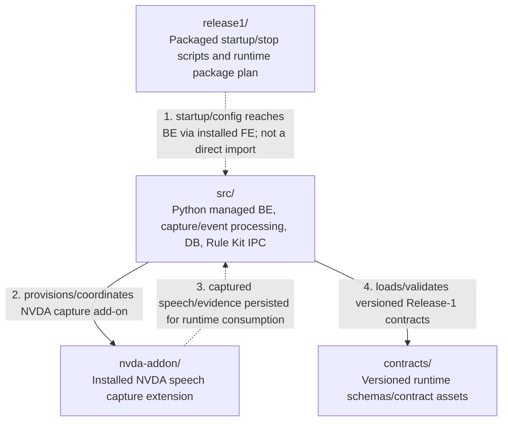

# D4Planner Backend — Production folder architecture (Level 2)

> Scope: production **direct children** of `d4planner-be/` (level 3 from `d4planner/`). Do not expand nested Python subpackages here. [Parent architecture](../architecture.md).

## Direct production folder relationships

**Important:** The first edge is an **indirect package/startup relationship**: the `release1/start-d4planner.ps1` script launches **the installed FE**, whose Tauri native shell then owns the managed Python process. It is **not** a direct `release1 → src` Python import. Other edges denote runtime integration or contract consumption, not file-level function calls.

## Folder responsibilities

| Direct child | Production purpose | Evidence |
| --- | --- | --- |
| [`src/`](src/) | Python `d4planner` package: managed backend and production composition; equipment/capture/controller processing, durable assessment/SQLite, transport, Rule Kit worker/process/IPC and reporting gateway implementation. | `src/d4planner/managed_backend.py`, `production.py`, `runtime/`, `rulekit/`, `release1/` |
| [`nvda-addon/`](nvda-addon/) | NVDA global plugin capturing D4 speech using foreground PID controls and writing capture events for BE consumption. | `nvda-addon/addon/globalPlugins/d4plannerCapture/` |
| [`contracts/`](contracts/) | Versioned target/HUD/WS schema and runtime logging contract inputs loaded/packaged for runtime validation. | `src/d4planner/release1/target_repository.py`, `release1/package-plan.json` |
| [`release1/`](release1/) | Release-1 package configuration plus **installed** `start-d4planner.ps1` / `stop-d4planner.ps1`; only those production runtime assets are in scope, not UAT/installer/test scripts. | `release1/package-plan.json`, `start-d4planner.ps1`, `stop-d4planner.ps1` |

### Cross-component boundaries

- HUD Tauri owns `python -m d4planner.managed_backend`; BE does not own or independently launch the HUD in normal managed mode.
- `src/d4planner/rulekit/` is a **BE-internal** Node-worker process/IPC adapter, not the entire Rule Kit implementation. Rule Kit calculations, provider, snapshot compatibility and browser runtime are in the sibling [Rule Kit](../d4planner-rulekit/architecture.md).
- BE commits the stable **public HUD SQLite projection**. HUD's native reader reads it read-only; WebSocket carries notifications. The schema/contract is not a direct database mutation API exposed to FE.
- The `nvda-addon/` is a separately loaded NVDA extension. The dashed speech/evidence edge is **data persistence/consumption**, not a reverse Python module call.

## Deliberate exclusions

`tests/`, `artifacts/`, `docs/`, `tools/` (release/build/verification tooling) and `report-gateway/` (compatibility/maintenance entrypoint; production implementation lives in `src/d4planner/reporting/`) do not appear as nodes. Installer and UAT content coexisting in `release1/` does not become an extra production flow. No level-4 folder is diagrammed.
