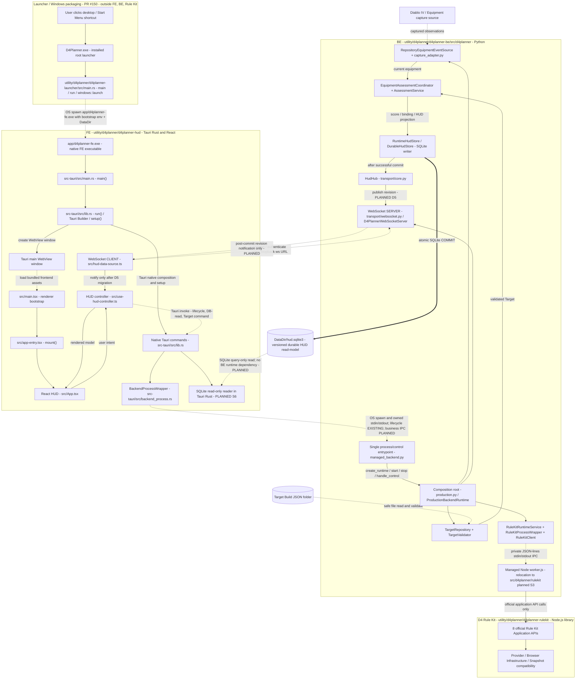
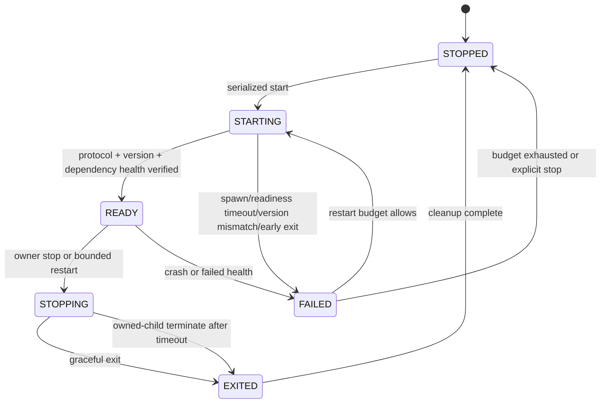

# ADR-001: Release 1 integration boundaries and lifecycle

- Status: `CANDIDATE`, technical review corrections complete; downstream evidence is recorded in `decisions-and-dependencies.md`
- Contract: `d4planner-r1-contract/1.0.0-candidate.6`
- Scope baseline: `R1-EQUIPMENT-20261025`
- References: Epic #137, S1 #138

## Decision

The native FE optionally owns one managed Backend child in integrated mode.
Viewer-only opens without BE/Node/WS credentials or readiness; BE startup failure
never prevents the WebView from opening. The Backend owns one managed Rule
Kit worker child. Each owner uses its own Template Method wrapper and an injected
process driver. Wrappers own lifecycle only. Target storage, assessment,
persistence, WebSocket transport, Rule Kit business calls, and rendering remain
separate ports in `interfaces.ts`.



The Release 1 equipment score does not require full Character Stats or a Rule
Kit evaluation. Skills, Paragon, Charms, Torment, DPS, inventory/stash search,
and Workspace are not scoring inputs. This does not remove the S3 lifecycle and
compatibility boundary.

BE owns capture, durable state, Equipment assessment and preparation of Build
JSON. Rule Kit owns snapshot compatibility, registry, provider/profile resolution
and Character Stats formula execution. BE calls Rule Kit APIs and forwards their
results; Tauri reads the public SQLite projection read-only; React never opens SQLite
or calls Rule Kit directly.
This ownership clarification adds no Application API or canonical schema fields.

The approved design reference and UI field mapping are maintained in
[ui-data-dictionary.md](ui-data-dictionary.md); decision authority and downstream
acceptance ownership are in [decisions-and-dependencies.md](decisions-and-dependencies.md).

## Lifecycle state machine



`spawn()` success is not READY. READY requires an application handshake whose
protocol version, configuration fingerprint, owner/child identities, generation,
and health checks match the launch specification. Concurrent `start()` calls
join the same in-flight start; they never spawn multiple children. `stop()` is
idempotent and suppresses restarts. Hide/collapse changes FE presentation only;
it never means exit.

### Ownership, exit, crash, and parent death

- Every process receives unguessable owner/child instance IDs and a monotonic
  generation. Only the recorded PID plus identity may be stopped. Never kill by
  `python`, `node`, or `chrome` name and never affect Diablo IV, Steam, OBS, or
  NVDA as a group.
- The owner first requests protocol-level shutdown, waits the configured graceful
  timeout, then may terminate only its verified child. Cleanup waits for exit,
  closes handles, revokes credentials, and invalidates generation-bound state.
- Unexpected exit emits `CRASHED`; restart uses bounded attempts in a rolling
  window with jitter/backoff. Exact budget values are deployment config, not an
  unapproved product default. Budget exhaustion reports FAILED.
- Parent-death containment must use a real OS ownership mechanism suitable for
  packaged Windows (for example a job object or inherited parent-death channel).
  A detached CLI or Scheduled Task is not a managed child. A child that detects
  parent loss stops accepting work, closes sessions, and exits within its bound.
- A worker restart changes `workerGeneration`; all old Rule Kit contexts,
  sessions, leases, preview tokens, and queued work are invalid and return
  `SESSION_INVALIDATED`. They are never silently rebound.

## Managed entrypoints and private handshakes

S2 supplies a managed BE entrypoint that accepts a private bootstrap descriptor
from an inherited handle or owner-only temporary file. Secrets must not appear
in argv, logs, source, fixtures, or review artifacts. The descriptor pins:

- loopback address and OS-assigned/configured port;
- one-time bootstrap credential and allowed native-app origin;
- target folder identifier/configuration (not a client-supplied path);
- owner instance, child generation, protocol/contract version, DataDir identity;
- readiness channel and configured resource/restart/time bounds.

BE reports READY only after durable state, Target repository, loopback listener,
authentication, and required migrations are healthy. Rule Kit READY similarly
requires IPC protocol compatibility, provider inventory, and reusable worker
health—not merely a Node/Chromium PID.

BE↔Rule Kit uses framed request/response IPC with correlation IDs, explicit
deadlines and generation binding. It is private to BE; FE never knows the worker
implementation. Existing Rule Kit canonical schema and eight Application APIs
remain unchanged.

## Timeout, lease, capacity, and cleanup contract

An operation deadline cancels one call. It does not expire a session. A session
lease/TTL controls idle reusable state and is renewed only by accepted work.
Implementations expose finite configuration for workers, browser contexts,
sessions, in-flight operations, and queues. Admission beyond capacity fails with
a typed busy/quota result; it cannot spawn per equipment event.

Queues are bounded and cancellation-aware. HUD updates may coalesce to the newest
committed revision for a binding. Commands and target activations may not be
dropped or reordered. On worker restart, cancellation, owner exit, or lease
expiry, contexts and sessions are closed once and their generation is revoked.

## Target list and activation

Only BE accesses one configured folder. It canonicalizes and resolves entries
beneath that root, ignores non-JSON files and symlinks escaping the root, caps
file count/size, and exposes opaque `targetId`s—not paths. Each listing records
byte length, validation status and SHA-256 of exact bytes. Invalid files can be
shown with safe error codes but cannot be selected. This does not waive the
`targetEntry` schema: `byteLength >= 1` and `contentSha256` always describes bytes
actually read. A filename hash may identify an entry internally, but is never
content evidence. Empty/unreadable files cannot be represented as such a descriptor;
producers must not fabricate values. Failure reporting uses the existing error
contract; a richer invalid-entry union would require a separately approved wire
change. Readable nonempty invalid JSON can have a real digest and INVALID status.

Activation repeats path containment, reads the bytes again, recomputes SHA-256,
validates the target and referenced canonical build schemas plus semantic rules
(unique criterion IDs, comparator shape, core weight greater than non-core), and
commits target bytes/hash/selection revision atomically. Changed, deleted, or
newly invalid content returns `TARGET_CHANGED`, `TARGET_NOT_FOUND`, or
`TARGET_INVALID`; it never activates the previously listed bytes under a new
hash. Selected target persistence stores ID, hash, policy version and selection
revision. Startup revalidates before restoring it.

## Assessment invariants

Identity (`slotId`, criterion `kind`, stable `entityId`, source group and
occurrence) is established before values are compared. Names are display-only
and fuzzy matching cannot establish identity. Each criterion contains one or
more typed parameters with stable parameter ID/index, comparator, operand and
unit. `AT_LEAST`/`AT_MOST` accept numbers only; `BETWEEN` requires an ordered
numeric range; typed equality and presence have distinct shapes. No global `>=`
rule exists.

All parameters use `ALL` aggregation. A missing parameter or unit/type mismatch
leaves the whole criterion UNKNOWN; all parameters must pass for criterion PASS;
an observed low/out-of-range parameter produces criterion WARN under the R1
rules. The criterion—not each parameter—is the unit of weight, issue counting
and recommendation priority.

Evidence distinguishes observed value, confirmed absence, incomplete evidence,
and unavailable evidence. A missing tooltip line is not confirmed absence; an
unknown slot is not empty. A confirmed missing/wrong core criterion is FAIL. A
matching core identity with a low roll is WARN. An unmet non-core criterion is
WARN. Insufficient evidence is UNKNOWN.

```text
score = 100 * passedWeight / evaluableWeight
evaluableWeight = weights(PASS + FAIL + WARN); UNKNOWN excluded
```

WARN has no partial credit and over-target is capped at the criterion weight.
Zero evaluable weight is `NO_DATA` with `value=null`; evaluable data with no PASS
is score `0`. FAIL issues count distinct criterion IDs only. An item contributes
to x/y only when every target criterion for it is PASS; WARN, UNKNOWN or FAIL
prevents item PASS. “Issues only” contains FAIL and WARN. Recommendation order
is core FAIL, core WARN, non-core WARN, then target order and stable criterion
ID. Transport retains the exact score and weights; half-up rounding occurs only
for final presentation. Evaluation counts remain internal diagnostics and must
not become a Coverage row/bar/badge in the approved HUD.

Every result binds runtime instance, character identity/current revision,
target ID/exact hash/selection revision, policy version and HUD revision. A
late result whose binding no longer matches is discarded. Switching target or
character publishes no old score under the new label.

BE may be READY before a game, character, Target or capture exists. The HUD
context is a closed union: `STARTUP`, `TARGET_ONLY`, `CHARACTER_ONLY`, `BOUND`,
or `TARGET_UNAVAILABLE`. Only `BOUND` contains an assessment binding. Other
states carry `NO_DATA`, no equipment rows and no invented IDs. A failed attempt
to select another Target may be reported beside the unchanged active Target;
the old label/binding remain paired with the old score. If the active Target is
deleted/invalidated, the binding and result are cleared atomically.

Release 1 has exactly one active playing-character context. This is a current
context stream, not multi-character/profile management. A committed contiguous
update may transition STARTUP/TARGET_ONLY to BOUND when that character is first
identified, or replace the active character with a new BOUND/NO_DATA context;
the previous character's score/equipment is cleared in that same revision.

## D5 DB-first, notification and command boundaries

The normative [SQLite/IPC specification](db-first.md) supersedes candidate.5's
full-HUD WebSocket transport and backend-generation revision resets. WS only
invalidates the DB read. Target list/select uses the same managed process pipe
as lifecycle control. No independent business entrypoint or DB write channel.

## Performance and operational evidence

Latency policy is `ASAP`: once evidence is sufficient, assess, commit, push and
render as soon as correctness permits. No deliberate delay, periodic polling or
batch timer is introduced. Bounded queues, coalescing and backpressure remain;
coalescing may discard superseded HUD revisions, never commands/activation
results. Record capture → confirmed evidence → assessment → commit → WS notification → native DB read
→ render timestamps and report P50/P95 when runtime exists. Rule Kit latency is
measured separately when called. S1 defines no fixed millisecond SLA and needs
no further Owner threshold decision.

The HUD is a normal native window and reuses StreamOps' existing
`window_capture` scene-profile capability (`streamops/server/scene_profiles.py`)
and existing OBS input create/update path
(`streamops/server/obs/profile_scene.py`). S1 adds no capture subsystem and no
OBS/Steam Link adapter. Verifying selection/capture of the actual HUD window is
S6/S7 runtime evidence, not an S1 PASS claim.

Pin is approved as always-on-top only; it does not imply position locking or
persistence after restart. This ADR does not choose ports, DataDir or tasks;
those deployment values remain downstream configuration. Ports must not be
derived by concatenating `187` with a three-digit PR number.
