# Issues 226 / 227 — observed equipment topology

## Assessment and cause

AGREE / FIX_REQUIRED. The captured A inventory has `Ranged / EQUIPPED / Bow`,
`Off-Hand / EQUIPPED / Dagger`, and `Main Hand / EQUIPPED / Dagger`. The parser
omitted Bow, Crossbow and Dagger, the capture slot dictionary omitted Ranged,
and HUD rendered a fixed two-weapon list. Adding only item anchors incorrectly
assigns the bow to the preceding Boots slot. Item/slot validation is required.

Before: replay of 7,017 recorded events yields eight armour/jewellery items, no
weapons. After: eleven items and verified ranged/main-hand/off-hand topology.
The stash Crossbow is not equipped evidence. Private original events and replay
artifacts stay outside Git; tests use synthetic names and stats.

## Ownership and compatibility

`providers/maxroll/tooling/planner/equipment-layout.js` translates Rogue's captured
physical slots 10/11/12 to ranged/main_hand/off_hand. Other unsupported multiweapon
classes remain unsupported. The existing trusted layout pipe delivers that
catalogue to capture. No snapshot identity or trust pin is changed.

`observed_layout.py` intersects observed weapon slot/types against verified class
layouts. Only unanimous topology is VERIFIED. A dagger alone remains ambiguous;
explicit ranged or two observed daggers distinguish the three-weapon topology.
This verifies slot structure, never character identity. With no trusted catalogue,
explicit slots remain OBSERVED, not VERIFIED. Target selection does not participate.

The inventory header sequence CHARACTER / shoulder controls / name / title /
Weapon Damage supplies a context fingerprint. A different fingerprint or capture
session starts a new observation scope. Stored older rows are retained but excluded
from the current view; no automatic full DB reset or historical reprocessing.
The fingerprint is not authentication: identical names or unsupported/localized
headers cannot establish a character switch. Identity remains UNVERIFIED.

`equipment_scope` persists scope, header parsing state, observations and derived
layout in the checkpoint transaction. Parser restart retains the scope, and
source failure preserves the saved view. Legacy databases without that table
remain readable. Changes of visible scope/layout advance the revision; the initial
empty scope does not add a spurious equipment revision.

HUD's optional `currentEquipment.layout` is an additive display contract with
UNKNOWN/OBSERVED/VERIFIED and ordered slot IDs. Old snapshots retain their old
presentation. React renders BE slots and labels, and contains no class registry.
Calculation APIs, canonical Build schema, Target and scoring rules are unchanged.

## Flow (implemented)

```mermaid
flowchart LR
  RK["equipment-layout.js: layoutFromCoverage"] -->|"1 call: verified catalogue through existing Worker"| CH["equipment_layout_channel.py: LayoutInbox"]
  CH -->|"2 call: apply layout"| S["supervisor.py: _apply_equipment_layout"]
  S -->|"3 call: consume event"| P["projector.py: consume"]
  P -->|"4 call: detect_layout"| L["observed_layout.py: topology and scope"]
  L -.->|"5 return: derived layout"| P
  P -->|"6 call: commit_event"| R["repository.py: atomic scope/items/checkpoint"]
  R -.->|"7 return: commit complete"| P
  B["production.py: refresh_current_equipment"] -->|"8 call: projection_snapshot"| R
  R -.->|"9 return: consistent scoped rows/layout"| B
  B -->|"10 call: current_view"| V["current_view.py: display projection"]
  V -.->|"11 return: optional layout"| B
  B -->|"12 publish: existing HUD database/transport"| H["CurrentEquipment.tsx: equipmentSlots/CurrentList"]
```

## Validation and limitations

Run `pytest tests/test_observed_equipment_layout.py tests/test_equipment_projector.py
 tests/test_equipment_resolvers.py tests/test_current_equipment_hud.py` in the BE
package with dev dependencies. Run HUD `npm test`/`npm run build` and provider
`node --test tests/unit/equipment-layout.test.js`. Full regression also requires
locked dependencies in browser-infra, application, snapshot-management and Maxroll.

For authorized private events use `tools/replay_equipment_layout.py --events
/private/events.jsonl --layouts tests/fixtures/equipment/verified_equipment_layouts.json
--output /private/new-result`. The output directory must be new. It contains private
item names, not a distributable fixture or a public CI artifact.

MagicPath candidate: project 458763473602621440, component 458765764401446912,
revision 474737446710546432. Built from the latest 24-revision baseline; preserves
Talisman and Preview Lab, adds a design-only layout selector. This is a candidate,
not an approved Golden. Owner visual approval and live Diablo IV focus/controller
UAT are separate gates. Windows VM replay does not substitute for live game UAT.
