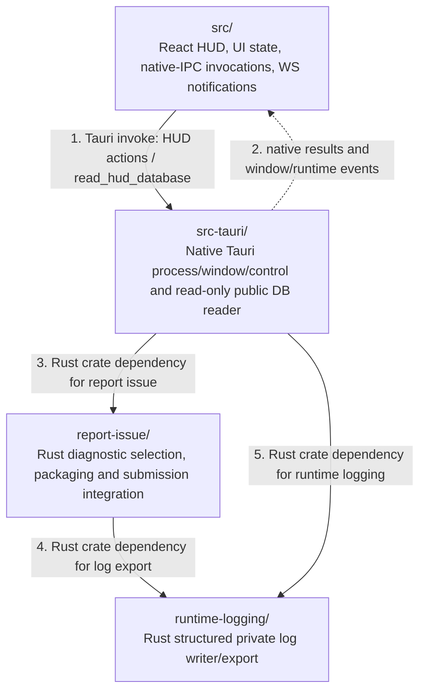

# D4Planner HUD — Production folder architecture (Level 2)

> Scope: only production **direct children** of `d4planner-hud/` (level 3 from `d4planner/`). The diagram does not expand `src/`, `src-tauri/` or other descendants. [Parent architecture](../architecture.md).

## Direct production folder relationships

## Folder responsibilities

| Direct child | Production purpose | Source verification |
| --- | --- | --- |
| [`src/`](src/) | React UI/overlay, runtime controls, HUD model validation, WebSocket *notification* handling and native database read requests. | `src/App.tsx`, `src/hud-data-source.ts`, `src/use-hud-controller.ts` |
| [`src-tauri/`](src-tauri/) | Native Tauri shell; owner of backend lifecycle/control IPC, window, Planner command and SQLite public-projection read-only access. | `src-tauri/src/lib.rs`, `backend_process.rs`, `hud_reader.rs`, `planner.rs` |
| [`report-issue/`](report-issue/) | Rust library for private diagnostic bundle and report operations; invoked by Tauri. | `src-tauri/Cargo.toml`, `report-issue/src/lib.rs` |
| [`runtime-logging/`](runtime-logging/) | Rust runtime logger and log export, consumed by Tauri and the report-issue crate. | `src-tauri/Cargo.toml`, `report-issue/src/lib.rs`, `runtime-logging/src/lib.rs` |

### Cross-boundary runtime behavior

- Tauri (in `src-tauri/`) starts and controls the managed Python backend in the sibling [BE component](../d4planner-be/architecture.md); this external link belongs in the **parent** architecture diagram, not as an invented HUD child.
- BE commits HUD public SQLite; Tauri reads it read-only when signaled by a BE WebSocket notification. A WS notification is **not** an SQLite payload or direct BE-to-React model push.
- Report submission may use the BE-owned local reporting gateway; this is a cross-component interaction. The `report-issue/` folder is a production Rust dependency, not a test utility.

## Deliberate exclusions

`tests/`, `reader-tests/`, `lifecycle-tests/`, `scripts/`, `docs/` and test-only files are outside these diagrams. `src/` contains some colocated tests, but the **folder itself** is production. No files beneath level 3 appear as nodes.
