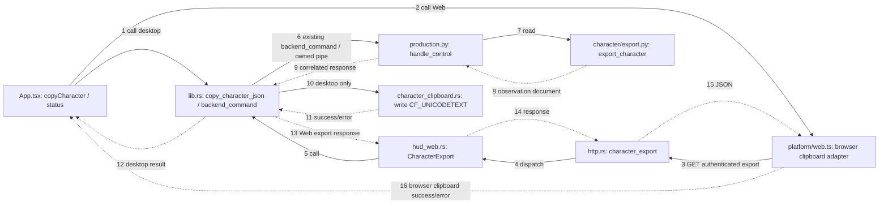

# Copy Character JSON

The HUD menu action copies a BE-owned observation document for AI analysis.
It does not produce a Target Build, canonical Rule Kit build, or Maxroll native
build. No calculation, target mutation, capture startup, or upload occurs.

## Assessment and reference

PARTIALLY_AGREE / FIX_REQUIRED: reuse the MagicPath v25 menu at component
458765764401446912, revision 474737446710546432. Its prototype uses fixtures,
fixed weapon slots, and excludes Talisman. Production must read the durable
source rather than serialize the display-only HUD. Layout comes from the BE;
unknown character identity stays unknown, regardless of a selected Target.
The implementation reference is not an automatic approval of a new Golden.

## Contract and ownership

`character.export` with empty params uses the existing owned managed-control
protocol and correlation/timeout/error handling. BE reads equipment, empty-slot
receipts and Talisman in one read-only SQLite transaction, scoped to one capture
session and inventory context start sequence. It never joins the newest Talisman
session to older equipment. Stored item JSON (including unrecognized fields,
raw item tooltip metadata, nulls, ordering and Unicode) is retained. This is not
an export of the raw event journal. Talisman attributes/set tiers are preserved;
repeated equivalent Charm observations are deduplicated and only the latest
Seal is selected, without claiming physical Charm positions.

The version is `d4planner-character-observations/v1`:

- `character`: identity UNVERIFIED, name null (current observation store has no
  verified name; no inference from Target or hashed inventory header).
- `capture`: source session, scope start, equipment revision, active-session or
  last-known freshness; active session does not mean authenticated identity.
- `layout`: existing observed/verified topology.
- `equipment`: original stored item objects plus slot/index, fingerprint,
  confidence, observation time and source event range.
- `confirmedEmptySlots`: explicit empty observations in the same scope.
- `notObservedSlots`: missing observations, never inferred empty; unresolved
  physical rings are disclosed in coverage rather than labelled empty.
- `talisman`: scoped equipped observations and unverified Charm positions.
- `coverage`: Skills/Paragon not captured, identity/ring-position limitations.

New empty receipts are persisted atomically with equipment/checkpoint; re-equip
clears receipts for occupied slots. Legacy empty evidence is not reconstructed
from absence. Old schemas remain readable, but missing observation scope fails
with CHARACTER_NO_DATA instead of guessing ownership.

Bounds: 256 equipment/Talisman observation records, 512,000 encoded bytes,
0.5-second SQLite busy timeout and 3-second query progress budget. Oversize is
rejected, never silently truncated. Internal IPC is bounded and times out.
Invalid, unavailable and empty sources have explicit CHARACTER_* errors. Neither
paths, credentials nor payload contents are added to runtime diagnostics.

Desktop fetches through native BE control then writes CF_UNICODETEXT to its
window-owned Windows clipboard. The existing HUD Web server offers authenticated
GET `/api/v1/character/export` with `hud.read`, no-store and existing origin/Host
checks. Web copies to the requesting browser's clipboard, never the PC clipboard.
Secure-context/clipboard permission failures show an error, not fake success.
A later click may retry; no implicit retry writes a changed document.

The button is disabled while copying or when HUD has no character-data hint.
A hint is not authoritative: BE rechecks source availability on each click.

## Validation

BE: `pytest tests/test_character_export.py tests/test_observed_equipment_layout.py`
plus full regression. HUD: `npm test && npm run build`. HTTP/auth:
`cargo test --locked --manifest-path src-hud-server/Cargo.toml`.

Browser E2E must read actual clipboard text after clicking and compare JSON to
BE output, including Unicode/null values. Windows installed testing uses a
synthetic equipment DB, real native IPC and Windows clipboard read-back.
Verify no-data/denied clipboard/Backend offline, repeat clicks, scope switches,
no stale Talisman, and existing Target/Create Build/Report behavior. VM evidence
is distinct from Android and live Diablo IV focus/controller UAT. Do not test A
without separate authorization. No generated private artifacts belong in Git.
