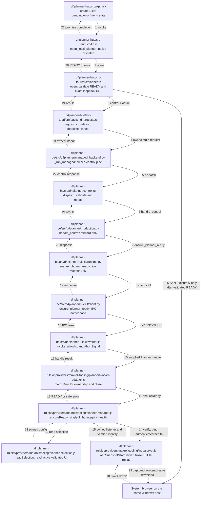

# Create Build through the owned Rule Kit runtime (#173)

## Decision and scope

**PARTIALLY_AGREE / FIX_REQUIRED.** The HUD already has Target/Report Issue actions,
Tauri already owns a correlated managed BE pipe, and BE already owns the Node
Worker. The provider's HTTP replay server already validates a private UI package
and provides native JSON download/import. None of those paths previously exposed
Create Build. Reuse those boundaries; do not add a gateway or use the Linux
`tooling/web/cli.py` PID manager on Windows.

The server runs **inside the existing Rule Kit Worker process**. Its PID is the
Worker PID, not an extra Node/Chromium process. `PlannerServerManager` owns the
listener; Worker disposal closes it. Process termination also releases the port.
This removes a child-process orphan/Windows PID-reuse boundary. HTTP and calculation
share the Worker event loop, but opening Planner neither selects calculation
snapshots nor changes sessions. Concurrent IPC/session regression tests cover this.

`application/src/runtime/bootstrap.js` is unchanged. Its indexed calculation
composition still supplies the eight Application APIs and Snapshot Management.
The provider-owned `tooling/planner/worker-adapter.js` adds an internal Planner
handle before delegating to the host Worker. It lives outside the indexed
calculation execution tree, so this UI feature does not invalidate existing
calculation compatibility bindings. There is no fake compatibility binding.

Calculation **UNAVAILABLE** (no compatible active calculation snapshot) does not
block Planner. A completely unavailable Worker/backend does: Create Build returns
`PLANNER_UNAVAILABLE`, without silently restarting the application. The unchanged
production bootstrap still requires its installed browser runtime at Worker
startup; Planner itself does not launch Chromium. The Windows installer already
includes that public browser runtime.

## Implemented control flow

Every node below is an actual file; call edges are solid and return edges dashed.
Paths are relative to `utility/d4planner`, except the provider paths expanded below.



Bootstrap/lifecycle ownership remains Root Launcher → Tauri → BE → Worker.
The adapter wraps composition close to stop its listener before calculation
disposal. No return edge above is a reverse dependency. MagicPath approval is a
separate gate, not a proposed runtime boundary in this diagram.

## Internal protocol and failure behavior

HUD invokes `open_local_planner` without URL/command arguments. Native sends
`planner.ensureReady` with `{}` on `d4planner-control/v1`. BE forwards to the
Worker's separate `d4planner-local-planner/v1` namespace. The eight calculation
method names, their semantics, and canonical Build schema are unchanged.

Successful response:

```json
{"schemaVersion":"d4planner-local-planner/v1","status":"READY","url":"http://127.0.0.1:6085/","snapshotId":"validated-ui-id","manifestSha256":"<64 lower-case hex characters>","reused":true}
```

The port is runtime configuration; React never constructs it. Native requires the
exact configured `http://127.0.0.1:<port>/` URL (no query, alternate host, path,
credentials, or external scheme). A random per-listener health token and instance
identity bind readiness to the owned listener, Worker PID, snapshot ID and verified
manifest hash. A foreign HTTP 200 or existing PID never constitutes READY.

| Code | Meaning / HUD behavior |
|---|---|
| PLANNER_SNAPSHOT_UNAVAILABLE | No provisioned active UI package; ask operator to provision |
| PLANNER_SNAPSHOT_UNTRUSTED | Registry/receipt/manifest/blob validation failed; do not bind |
| PLANNER_START_FAILED | Owned listener could not start |
| PLANNER_HEALTH_FAILED | Startup/health deadline or identity failed |
| PLANNER_PORT_CONFLICT | Configured loopback port occupied; never kill/adopt foreign process |
| PLANNER_BUSY | Concurrent native request/admission limit; retry after pending work |
| PLANNER_UNAVAILABLE | Backend/Worker/capability/browser-open unavailable |

Errors contain no filesystem paths or native build payload. Manager deadline is
12 seconds, health request 2 seconds, Worker client 14 seconds, native control 16
seconds. Cancellation propagates over both pipes; shared single-flight startup
continues for other live callers. The last cancellation prevents a late listener
from binding. BE continues processing Target/shutdown while Planner is pending.
READY reuse retains the selected snapshot for that Worker lifetime, even if a
capture command later updates the registry. This avoids silently changing build
provenance under an existing tab. Export edits before closing/restarting D4Planner.

## Windows provisioning and normal use

The public installer includes the provider's Planner manager/adapter/selection and
HTTP server/client/shell/native-transfer/UI validator modules, plus existing shared
store/browser/runtime dependencies. It excludes snapshots, raw responses, private
builds, capture configuration, and Linux CLI tooling.

Provision the existing provider `maxroll-capture-state/v1` registry and its selected
immutable UI package separately on the **same Windows host**. Default registry:
`<D4Planner DataRoot>/rulekit/planner/state/capture-state.json`. The `activeUi`
entry must be `VALIDATED`, with matching manifest, coverage and validation receipt
pins; `config.snapshotRoot` must be an absolute Windows path to the package store.
Use the existing capture/provisioning authority, preserving approved hashes and
authorization reference. Do not hand-create a validation receipt or add a fake
calculation binding. Registry checksum uses the existing Python canonical JSON
format. The UI capture registry is the single source of selection, read-only here.

One-time installation overrides, if required, are `D4_RULEKIT_PLANNER_STATE_ROOT`
and `D4_RULEKIT_PLANNER_PORT` (1024–65535; default 6085), inherited consistently by
Tauri and Rule Kit. Missing provisioning returns an actionable HUD error. A Linux
path/config is not a valid provisioned Windows installation.

Normal use: launch installed D4Planner → menu **⋮ → Create Build**. The pending
entry reads **Opening Planner…** and is disabled. Browser opens only after READY,
on Windows localhost. Equipment/Skills/Paragon and Native Export/Import are the
same frozen UI features as #175. No SSH, terminal, online capture, canonical
conversion, Target write/selection, or calculation is performed by Create Build.
Close D4Planner normally to close the owned listener; the existing Root Launcher
stop command also uses the existing ownership/Job Object lifecycle. Closing a
browser tab alone leaves the server available for reuse while D4Planner runs.

## Design gate

Approved Golden remains project `458763473602621440`, component
`458765764401446912`, revision `464988421014827008`. Proposed MagicPath revision
**`468388849622609920`** adds Create Build next to Report Issue/Target Build,
including pending/error treatment and an unclipped menu. Status:
**PENDING_OWNER_APPROVAL**. The proposal is a design preview, not a runtime test.
Do not replace `tests/visual/golden/manifest.json` with a source screenshot or treat
DOM/native test PASS as Golden approval. Merge readiness also requires Owner
focus/controller UAT with Diablo IV on Windows A; the isolated VM cannot prove it.

## Reproducible local checks

Run BE `pytest` with its installed virtualenv on PATH and `F2_TEST_CHROMIUM` pointing
to the installed browser; provider `npm test` uses `BROWSER_INFRA_CHROMIUM_PATH`.
HUD: `npm test`, `npm run build`, and `cargo test --manifest-path
lifecycle-tests/Cargo.toml`. Manager tests use real loopback HTTP and synthetic,
explicitly labelled package fixtures for negative cases.

One command tests the actual production managed IPC/HTTP path against a privately
provisioned UI package and the pinned same-version online reference:

```bash
python utility/d4planner/d4planner-be/tools/planner_acceptance.py \
  --state-root /private/capture-state \
  --reference /private/same-version-online-reference \
  --chromium /absolute/chromium \
  --output /private/new-evidence-directory
```

Requires clean committed HEAD and the existing provider browser/visual test
dependencies. It uses an isolated temporary DataRoot/free port, no calculation
selection, the existing full desktop/mobile UI scenarios, image decoding,
negative icon mutations, native download/round-trip, offline checks, reuse,
Target forwarding and shutdown. JSON/Markdown reports and raw visuals stay private.
Real Windows installation/start/open/cleanup is a separate VM acceptance; Linux
tests must never be labelled Windows installed PASS. `CI_NOT_CHECKED`.
