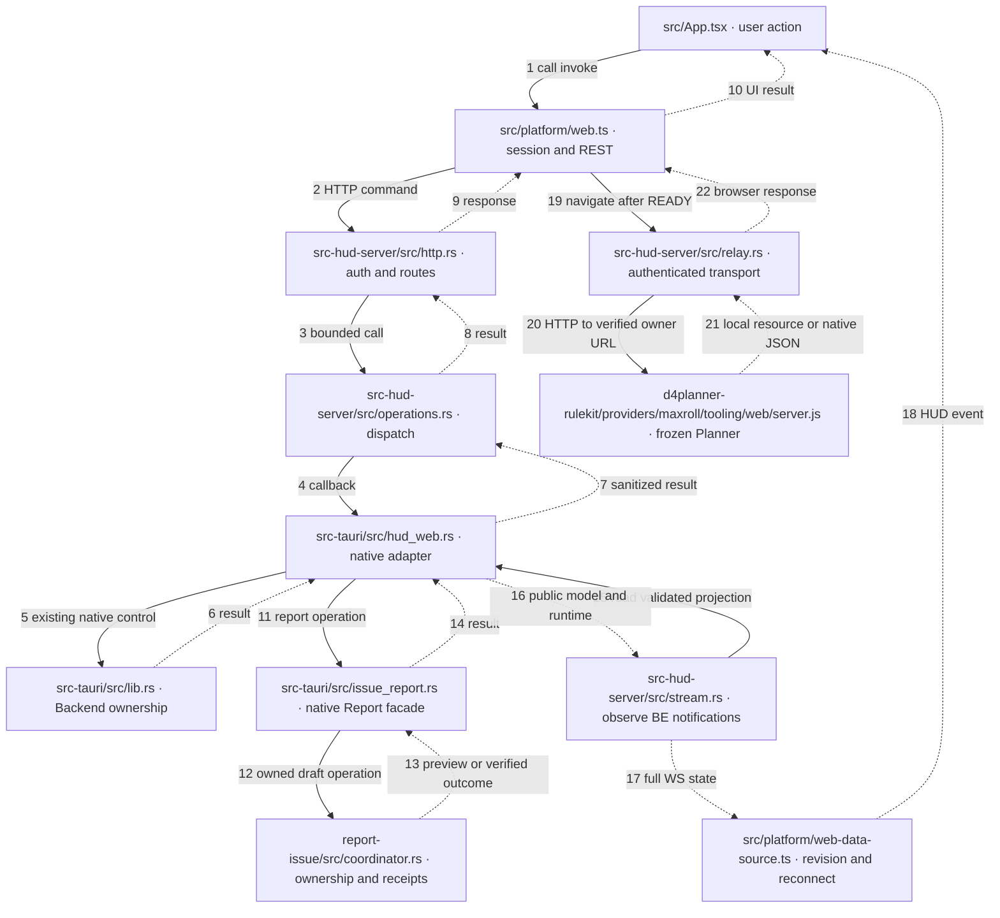

# Issue #201 — implementation and acceptance record

## Independent assessment

**PARTIALLY_AGREE / FIX_REQUIRED.** The shared React tree and native Backend/Report commands already provide the required business behavior. Browser code cannot use Tauri IPC, and the BE notification socket carries revisions rather than public models. A Rust library in the existing Tauri PID is sufficient: subscribe to notifications, read the existing validated public SQLite projection, and send full models over authenticated WS. Explicit REST adapters call existing native operations.

Owner subsequently approved private-LAN access, Backend/Capture Start/Stop/Restart, and omission of window-only controls. Those decisions supersede the original issue's loopback-only/read-only exclusions. Default binding remains loopback. LAN requires TLS and one-time owner provisioning; neither firewall nor Windows A was modified.

Planner remains owned by Rule Kit. A second authenticated listener in the HUD process transports browser requests to the verified loopback Planner. A distinct port isolates captured scripts from HUD session APIs. This adapter never selects snapshots, starts Node itself, or supplies missing resources. The tradeoff is a second LAN port and certificate provisioning. Server-side filtering removes native credentials before forwarding.

Report collection, encryption, gateway and uncertain-outcome recovery remain in the existing Report module. A shared coordinator adds actor ownership and durable terminal receipts so Desktop and Web cannot discard or resume each other's reports.

## Implemented execution boundaries

Paths below are relative to `d4planner-hud`, except the Rule Kit node. Solid edges are calls; dotted edges are returned results/events. Browser HTTP does not pass through Calculation APIs.



`src-tauri/src/lib.rs` starts/stops `src-hud-server/src/lifecycle.rs` inside Tauri. No new daemon, Calculation API, canonical schema, or installer payload of private assets is introduced. The Rust dependency is linked into the existing executable.

## Local evidence

Private evidence root on F: `/home/huy/.local/share/streamops/issue201/`. Generated screenshots, tokens, native payloads and private Planner assets are excluded from Git. Exact commit is recorded in the PR, together with the final execution result.

| Evidence | Result / boundary |
|---|---|
| `react-final.log`, `build-final.log` | Shared React tests and production build; includes Report terminal resume, WS rollback/epoch/reconnect and Target revision checks. |
| `server-final.log` | 13 Rust tests: auth/CSRF/scopes, Host/origin, real HTTP lifecycle, notification reads, mutation timeout ownership, TLS configuration, relay upstream restrictions. |
| `report-final.log`, `report-process-final.log` | 29 Report tests and two real local-gateway process tests with isolated fake remote; no real GitHub Issue/asset upload. |
| `browser-final/report.json` | HTTP browser workflow, shared React, real Report coordinator; explicitly synthetic native Host. Nine checks PASS, cleanup included. |
| `windows-final/workflow.json` | Real Windows Tauri + BE + Edge: Stop/Start/Restart, matching native state, connected full WS model and dbId/revision equality, Report preview/cancel. |
| `windows/native-tests-final.log` | 36 native Windows tests; source-built debug executable, not an installer acceptance claim. |
| `windows/visual/` | PC/Web expected/actual/diff at 960×720, shared live data; Current, menu, Report, Collect Logs, Compare, Runtime. Same test backdrop behind translucent panels. |
| `tls/report.json` | HTTPS with verified test CA/IP SAN; Secure/HttpOnly/SameSite cookie; both ports released. Phone CA enrollment is not emulated. |
| `planner-relay-2/export/export-report.json` | Existing frozen Planner through authenticated relay: actual desktop/mobile downloads, rich multi-profile native round-trip, empty sockets, tamper/version rejection, zero external network completions. Blocked CSP attempts are not counted as completed requests. |
| `final-regression/` | Existing Application, Snapshot Management, Provider and Browser Infrastructure suites; configured Chromium used for browser suites. |

Windows QA uses the isolated `d4planner-builder` VM and disposable DataRoot, never Windows A. HUD and Planner relay listeners were observed in Tauri PID 1360 on ports 19090/19091. Ports are QA choices, not product constants. Backend starts with Calculation UNAVAILABLE when no private calculation snapshot is provisioned. Owned processes are closed and listeners checked after QA.

### Findings caught during QA

- A mock notification server accepted a missing HTTP Origin. Real BE rejected that handshake although protocol hello contained the correct origin. `stream.rs` now sends the bootstrap Origin in the HTTP handshake; the test explicitly asserts it.
- Returning a terminal Report receipt to the old preview-only renderer could access absent `files`. The shared renderer now handles verified terminal states. A prior terminal report cannot cancel a different current draft.
- Initial VM startup lacked Chromium provisioning and used an incorrectly owned disposable DataRoot. Corrected only the test environment; did not relax READY, storage ownership, or Rule Kit checks.

## Acceptance ledger

AUTO means F automation. MAN means an actual device/operator gate, not mobile emulation.

| ID | Expected → actual | Status / owner |
|---|---|---|
| HS-01 | Same PID → native Windows PID owns both HTTP ports | PASS AUTO |
| HS-02 | Shared build and health → embedded assets, authenticated health, live WS/runtime | PASS AUTO |
| HS-03 | Tauri shutdown releases ports → real Windows close and Rust lifecycle checks | PASS AUTO |
| HS-04 | Safe failures → foreign port retained, invalid configuration denied, BE-unavailable HUD remains accessible | PASS AUTO |
| WEB-01 | One React tree → shared entry/components/CSS plus platform adapter | PASS AUTO |
| WEB-02 | Complete browser functionality → shared Current/Compare/menu/Runtime/Report/Collect Logs, Planner relay | PASS AUTO within exercised flows; physical game capture MAN |
| WEB-03 | Full WS projection → real BE handshake, validated projection, no REST display polling | PASS AUTO |
| WEB-04 | dbId/epoch/revision → native equality, regression/epoch tests | PASS AUTO |
| WEB-05 | Recovery → real BE restart plus reconnect/stale/rollback tests | PASS AUTO |
| WEB-06 | Target contract → existing native forwarding and listed hash/revision validation | PASS AUTO; VM empty Target directory verified |
| WEB-07 | Visual parity and Golden → shared layouts/text match for Current/menu/Report/Collect Logs. Exact pixel equality is not universal: OS scrollbar/antialiasing, approved omitted pin, private Runtime values and dynamic uptime differ | BLOCKED visual approval; no new Golden asserted |
| WEB-08 | Desktop regression → shared React/native Windows tests and real native control | PASS AUTO; Diablo focus/controller NOT_RUN MAN |
| API-01 | Auth/scopes → missing credential, CSRF and permission rejection | PASS AUTO |
| API-02 | Safe preview → real Report collection, Windows browser preview/cancel | PASS AUTO |
| API-03 | Report ID/consent → coordinator/Report validation; no remote submission without consent | PASS AUTO |
| API-04 | Verified outcome → existing gateway process with isolated fake remote and encryption | PASS AUTO mock remote; live submission intentionally NOT_RUN |
| API-05 | Recovery/idempotency → gateway reconcile tests, terminal receipts and cross-actor isolation | PASS AUTO |
| API-06 | Reuse → unchanged Report/gateway business engine, thin coordinator/adapters | PASS AUTO |
| API-07 | Privacy → strict routes, private fields removed, no raw paths/credentials forwarded, traversal/actor rejection | PASS AUTO |
| LAN/phone | Same-LAN HTTPS, touch, popup/download → TLS/browser automation completed; actual phone trust/network/UI requires Owner | NOT_RUN MAN |

No `FULL_PASS`, release readiness or new MagicPath approval is claimed. Screenshots of this implementation are comparison evidence, not Golden images. Native capture/game focus, physical Android and final visual approval remain explicit gates.

## Reproduction

See [usage and API](hud-web.md). From the HUD directory:

```text
npm test -- --run
npm run build
cargo test --manifest-path src-hud-server/Cargo.toml
cargo test --manifest-path report-issue/Cargo.toml
cargo build --manifest-path src-hud-server/Cargo.toml --example browser_fixture
python scripts/web-acceptance.py --output /private/new-qa-directory
```

On the isolated Windows fixture, build/test `src-tauri/Cargo.toml` with its provisioned Node/Python/Chromium, then run `scripts/windows-web-acceptance.py` from F with `--native-cdp`, `--browser-cdp`, `--url`, `--token-file`, and private `--output`. Debugging ports are QA-only and must not be enabled for normal owner use.

**CI_NOT_CHECKED.** No merge, release, public artifact publication or production deployment.
