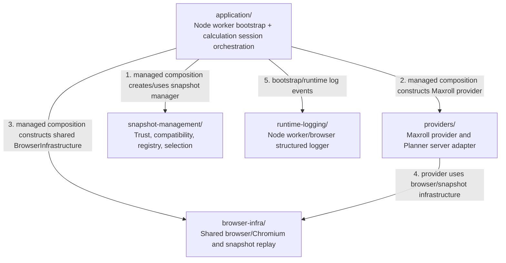

# D4Planner Rule Kit — Production folder architecture (Level 2)

> Scope: **direct production children** of `d4planner-rulekit/` (level 3 from `d4planner/`). Nested modules are cited only as evidence, never expanded into diagram nodes. [Parent architecture](../architecture.md).

## Direct production folder relationships

**Diagram semantics:** these are **runtime composition/dependency** relationships, not a single serial function call sequence. `1–5` identify the interactions, not an assertion that provider calculation can begin before startup completes. Responses and disposal are intentionally omitted to avoid suggesting circular calls.

## Folder responsibilities

| Direct child | Production purpose | Verified source |
| --- | --- | --- |
| [`application/`](application/) | Provider-agnostic calculation API, sessions, revisions, preview/commit/reset, and private process bootstrap/composition. | `application/src/runtime/bootstrap.js`, `production-composition.js`, `managed-snapshot-composition.js` |
| [`providers/`](providers/) | Maxroll calculation provider, versioned codec/metric mapping, offline Planner UI/HTTP adapter. | `providers/maxroll/src/provider.js`, `providers/maxroll/tooling/planner/` |
| [`browser-infra/`](browser-infra/) | Shared headless Chromium process, browser leases and generic immutable web-snapshot capture/replay. | `browser-infra/src/` |
| [`snapshot-management/`](snapshot-management/) | Production snapshot registry, trust/compatibility, resolver/strategy selection and management protocol. | `snapshot-management/src/`, `compatibility/` |
| [`runtime-logging/`](runtime-logging/) | Node worker/browser bounded diagnostic logging; required directly by the Rule Kit application bootstrap/composition. | `runtime-logging/src/logger.js`, `application/src/runtime/bootstrap.js` |

### Runtime integration boundary

- The BE-owned worker adapter (`../d4planner-be/src/d4planner/rulekit/worker.js`) is loaded by `application/src/runtime/bootstrap.js` through a supplied absolute path. The adapter carries the private IPC contract; Rule Kit itself owns Application composition, provider and snapshot compatibility.
- The **Application core** is provider-agnostic. The **private composition** in `application/src/runtime/` imports and wires provider, browser and snapshot-management modules; a static `application → providers` arrow refers to that private runtime wiring, **not** to the public Application package's API importing Maxroll.
- The Maxroll provider depends on browser infrastructure; browser infrastructure does not depend on Maxroll. Snapshot activation/restart is handled through the Rule Kit-owned manager, with BE coordinating only its owned worker lifecycle.

## Deliberate exclusions

`tests/`, `fixtures/`, `references/`, `docs/`, `contracts/` as reference-only materials, `ci.test.py`, `ci.release.py`, and capture/build scripts are not drawn. `src/d4_rulekit/` is the standalone Python DSL/schema CLI package and is **not invoked on the verified installed managed Node calculation/Planner path**; therefore it is not drawn as if part of this runtime. No level-4 nodes are included.
