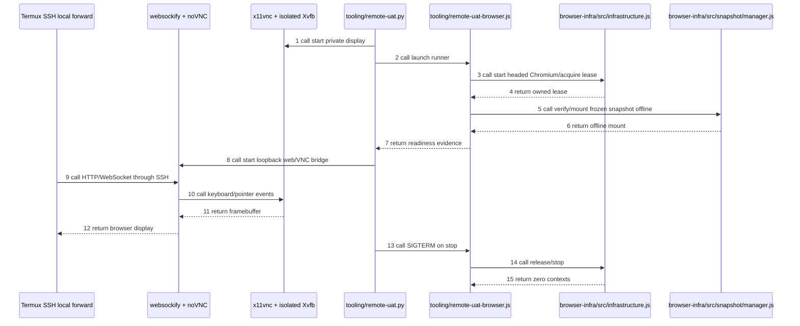

# Remote frozen Planner UAT (#173)

UI-only Linux tooling. The owner operates a headed Chromium through noVNC over
SSH local forwarding. Calculation/provider contracts and native Save are unchanged.
The empty-socket/export work in #173 is outside this UAT. Native Save still requires
the unavailable online endpoint; this runner does not export builds.

## Assessment and boundary

The earlier local `editor.js` prototype already supported headed mode, but was
uncommitted and included unfinished export handling. This runner reuses the same
BrowserInfrastructure, snapshot manager and exact compatibility definitions without
making that prototype a production dependency. It introduces no snapshot HTTP proxy,
new public Rule Kit API, snapshot update or online fallback.



## Dependencies and configuration

Requires Linux `/proc`, Python 3.12+, Node 20+, Xvfb, x11vnc, xauth, xdpyinfo,
noVNC static files, websockify and an installed Chromium executable. Install the
existing browser-infra npm dependencies with `npm ci --ignore-scripts` in that
package. No auto-download happens during start.

The verified F setup uses user-local Ubuntu packages (Xvfb 21.1.12,
x11vnc 0.9.16, noVNC 1.3.0, libvncserver/client 0.9.14) extracted with
`apt-get download` + `dpkg-deb -x`; websockify 0.13.0 is in an isolated Python venv.
No sudo installation, systemd unit, existing SSH config or host firewall change.
Upstream: [noVNC](https://github.com/novnc/noVNC),
[websockify](https://github.com/novnc/websockify).

Create a private config outside Git with absolute paths:

```json
{
  "snapshotRoot": "/private/existing-snapshot-store",
  "snapshotId": "<explicit installed snapshot ID>",
  "manifestSha256": "<trusted exact manifest SHA-256>",
  "chromium": "/path/to/chrome",
  "xvfb": "/path/to/Xvfb",
  "x11vnc": "/path/to/x11vnc",
  "websockify": "/path/to/venv/bin/websockify",
  "novnc": "/path/to/novnc/static-root",
  "libraryPath": "/optional/extracted/usr/lib/x86_64-linux-gnu",
  "display": 173,
  "vncPort": 5903,
  "webPort": 6083
}
```

`libraryPath` is optional. No snapshot ID is hardcoded into the runner. An unknown
binding or wrong digest fails closed. The runtime directory must be private and
owned by the current user; logs/screenshots may contain private build information.

## Start, status, stop

From this directory:

```bash
python3 remote-uat.py start --config /private/uat-config.json --runtime /private/uat-runtime
python3 remote-uat.py status --runtime /private/uat-runtime
python3 remote-uat.py stop --runtime /private/uat-runtime
```

Start detaches an owned supervisor and waits for readiness. Repeated start reports
its existing state. The supervisor holds a lock, refuses occupied ports/displays,
and never kills a process merely because it occupies a requested port. A child
failure triggers cleanup of the owned stack. Stop checks PID start time and uses
pidfd signaling to avoid targeting a reused PID. Xauthority is private; Xvfb has
no TCP listener. VNC and websockify bind `127.0.0.1` explicitly. Clipboard transfer
is disabled. No desktop window manager or terminal is started in the UAT display.

This is a trusted-host, SSH-only UAT environment: loopback VNC has no additional
password, so other local users on F could connect. It must not be forwarded by a
public reverse proxy or bound to LAN. The web root is noVNC static files, never the
snapshot/config/runtime directory. Browser replay disables transport, service
workers and WebSockets and aborts uncaptured requests; the noVNC viewer uses a
separate browser/network path. URL text still displays the original Maxroll origin.

Closing Chromium or the eight-hour browser lease expiring closes the session and
supervisor. Disconnecting the SSH viewer leaves the session available for reconnect.
Build changes are in memory; stop/restart discards them. Do not use Save for export.

## Android Termux handoff

Run on Android Termux, not inside the remote F shell, keeping this session open:

```bash
ssh -N -o ExitOnForwardFailure=yes -o ServerAliveInterval=30 -o ServerAliveCountMax=3 \
  -L 127.0.0.1:6083:127.0.0.1:6083 huy@100.68.179.68
```

This is F's Tailscale address as observed during setup. The Android device needs
the existing SSH route to F (Tailscale connected for this address); alternatively
use the same F hostname/address used by the owner's working SSH session. SSH
credentials remain on the owner's device. If Android port 6083 is occupied, use
`-L 127.0.0.1:6084:127.0.0.1:6083` and open port 6084 below.

Open Chrome Android:

`http://127.0.0.1:6083/vnc.html?autoconnect=1&resize=scale`

Owner MAN:

1. Confirm a Chromium window containing the frozen Planner, game version 3.2.1.73552.
2. Scroll to New Profile and create a draft.
3. Change level and select/edit equipment.
4. In Skills, use List view to allocate a point; try Paragon pan/zoom/node allocation.
5. Open the left noVNC toolbar/keyboard control to enter text. Test tap and dragging.
6. Disconnect/reconnect the tunnel; confirm the same session remains.

Landscape orientation and local scaling are usually easier for the 1280×900
remote display. Android keyboard/touch behavior remains Owner MAN; a desktop
browser or mobile emulation is not a substitute. Some frozen sprite assets are
missing as recorded in #173; do not fetch or upgrade them during UAT.

## Evidence and local checks

`browser.json` records snapshot digest, offline replay diagnostics and CDP egress
counters. `browser-cleanup.json` records browser/context cleanup. `state.json`
records owned PID start times, ports and final cleanup status. `planner.png` is a
private startup screenshot. Keep all these outside Git/GitHub artifacts.

```bash
python3 -m unittest discover -s ../tests/tooling -v
node --check remote-uat-browser.js
```

R01/R02/R06: real headed frozen UI through localhost noVNC; inspect screenshot,
canvas connection and offline CDP counters. R03: real SSH-forwarded HTTP/WebSocket
interaction can be tested using an isolated loopback sshd/key, without changing the
host's port-22 authentication; this does not certify Android routing/credentials.
R07: start/stop/restart, verify owned PIDs/ports disappear. R08: compare existing
service PIDs/listeners before/after and test conflict refusal. R04/R05 stay Owner MAN.

LOCAL_PASS applies only to completed automated gates. CI_NOT_CHECKED; no Actions
polling, dispatch or rerun. No private snapshot distribution is authorized.
