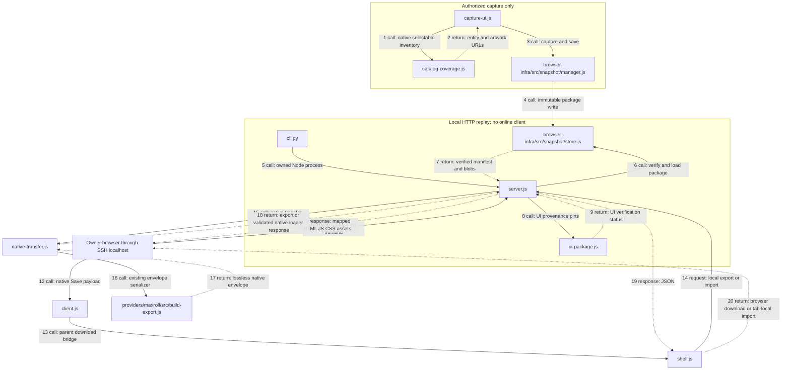

# Comprehensive local Planner acceptance — #173 / PR #175

This supersedes the earlier limited visual coverage in UI-CHECKPOINT.md and EXPORT.md. A loaded page, an equipped-slot sprite, or an HTTP 200 is not evidence that picker artwork is complete. Real Android acceptance remains separate from Chromium mobile emulation.

## Independent assessment

**AGREE / FIX_REQUIRED.** The previous capture observed only resources requested by a small set of UI interactions. The frozen frontend resolves picker artwork separately from equipped sprites, including class/sex image variants. An offline reproduction of the Starfall Coronet **picker** failed `Image.decode()` against the old package. Initial native category inspection found 630 missing URLs among 652 distinct artwork dependencies, even though equipped-slot checks passed. The previous visual test also captured the slot for a checkpoint named `equipment-tooltip`; that did not establish tooltip or picker correctness.

Not every picker is virtualized: the native detailed item library renders native category lists, while modifier/gem selectors also use virtual lists. The general failure is incomplete dependency discovery across unopened classes/categories and presentation variants. It is not evidence of an Android-specific image decoder defect.

**Current → proposed:** keep the existing HTTP replay and independent UI trust pins; extend the authorized capture pipeline with the native selectable category model, catalog artwork dependencies, static module/CSS/HTML dependencies, and representative full UI scenarios. No replacement UI, runtime downloads, calculation compatibility bypass, or new proxy is needed.

**Alternatives:** more DOM-only crawling repeats the blind spots; downloading all raw catalog items overstates selectable coverage; cloning native item eligibility rules creates a second rules implementation. `catalog-coverage.js` instead reads the native React category model without invoking selection callbacks. It fails explicitly if that internal model changes. This is version-sensitive provider tooling, not a new public interface.

**Impact:** original cards, artwork, modifiers, Skills and Paragon render in the user's browser. Existing native Export/Import remains independent of calculation. The new package never overwrites or promotes the calculation snapshot. Server startup still verifies the manifest, blobs, provenance and explicit UI trust pins.

**Risks:** internal category/rendering structure can change; capture requires authorized access and a consistent fingerprint. A patch label alone does not establish version identity. Browser emulation cannot prove Samsung Internet/Chrome Android downloads or touch ergonomics. Proprietary bytes and raw build/evidence files remain private; integrity and successful replay do not establish redistribution rights.

## Resource closure

`capture-ui.js` uses the existing BrowserInfrastructure and WebSnapshotManager with a clean context, disabled browser cache, blocked service workers, GET-only capture, bounded quiescence, content conflict detection, and final runtime/data fingerprint rechecks. Output must be a new snapshot ID.

Discovery combines:

- HTML script/link/image/srcset references; static and literal dynamic module imports.
- CSS `url()` and `@import`, resolved relative to the owning stylesheet.
- Runtime computed background/border/mask images, including `::before` and `::after`.
- Native class/slot/category lists before layout, search, or virtualization. Numeric user-owned instance IDs are distinct from catalog template IDs. Set IDs are distinguished from their selectable members.
- Every primary and class/sex artwork variant of selectable items; skill, affix, paragon, glyph, stone and item-set image fields.

The audit records `Entity ID → Image ID → URL → manifest entry → blob/hash/MIME`. HTTP browser tests independently re-enumerate the native category model and compare it with the captured inventory. Every captured image is decoded through the real HTTP server, with nonzero natural dimensions. Runtime tests cover picker search and last-row scrolling, equipped slots, editors and actual tooltip portals.

The website's `/favicon.ico` is classified separately as an optional site favicon, not a Planner item/icon. Missing login/account, ads/tracking and cloud APIs are also reported separately. No missing Planner resource is waived by a total counter. Static module closure includes conditional imports; they are not silently waived as “probably cloud”.

## Functional and visual evidence

`full-scenarios.js` uses the original UI for class/level, all equipment families and class-specific slots, Seal/Charm, equip/unequip, power, affix, temper, aspect, gem/empty socket, skill allocate/refund, paragon allocate/refund, glyph, board addition/rotation and pan/zoom. The four reported picker regressions are explicit cases: Starfall Coronet, Razorplate, Scoundrel's Leathers and Runic Skullcap. Mythic equipment is represented by Harlequin Crest. The full catalog inventory establishes artwork coverage; representative browser scenarios establish rendered behavior. Neither is presented as exhaustive testing of every possible build combination.

`full-ui-check.js` runs clean desktop and Pixel 7 contexts. Replay uses ordinary HTTP, **without Playwright request interception**. It records console exceptions, HTTP misses and external attempts/completions. On mobile it exercises native touch input; hover and right-click checks additionally inspect native desktop behavior under the narrow layout, not physical-device ergonomics.

Generate online references in a separately authorized preparation step:

```bash
node full-ui-check.js /private/online-reference-config.json
```

Configuration includes the exact UI snapshot pins, `chromium`, a new `output` directory and `online: true`. The reference must match the captured runtime/data and observed asset hashes. Reference screenshots are generated online, never copied from replay. The report contains screenshot SHA-256 values; pin the report hash for offline QA.

Tooltip checks assert the selected item's title before and after capture. They capture the visible native tooltip directly without scrolling its floating portal: automatic locator scrolling can move the pointer onto a different slot. Oversized mobile tooltips are compared within the actual native viewport, with no content masks.

The full visual gate compares desktop/mobile picker cards, artwork crops, editor, equipped slot, tooltip, skill and paragon states with the same native state and viewport. No masks are used. The existing 0.5% pixel-difference threshold is unchanged. Each picker artwork crop also has a negative mutation: hiding that exact background must fail the normal gate. A mutation merely changing the equipped slot cannot satisfy a picker regression.

## Native JSON

The existing `client.js → shell.js → native-transfer.js → src/build-export.js` path captures the actual native Save serialization. The download is initiated in the parent document; the sandbox/CSP remain unchanged. No account or online POST is required. The UI explicitly reports that cloud persistence did not occur.

Envelope: `maxroll-native-build-export/v1`, `MAXROLL_NATIVE_STATE`, complete `nativeState`, loader metadata, SHA-256 integrity and UI snapshot provenance. Import is tied to the exact UI snapshot ID and manifest hash. It uses the native profile loader, not a parallel serializer. State is tab-local: download before closing/reloading. Imported state is never published or persisted by a cloud backend.

The browser tests download actual files and compare the complete native state after import/export: the captured multi-profile build and a build created through UI with affixes, temper, aspect, gem, skills, glyph and rotated board. Separate tests retain `[null,null]`, assert profile switching, and reject invalid JSON, tampered integrity and a wrong snapshot. Unknown native fields are preserved by the transfer boundary, not converted or discarded.

Canonical conversion remains explicitly `UNSUPPORTED`: the published canonical socket schema cannot represent `[null,null]`; the UI package has no calculation compatibility binding. This does not block native export. No canonical schema, codec, engine or Application API was changed.

## One-command offline acceptance

Prerequisites are the existing Node/Chromium/Python tooling plus Pillow for private image comparisons. Prepare a private JSON configuration containing the server UI pins and:

```json
{
  "chromium": "/absolute/pinned/chrome",
  "output": "/private/new-acceptance-directory",
  "referenceDir": "/private/online-reference-directory",
  "referenceReportSha256": "<sha256 of online report.json>",
  "calculation": {
    "snapshotRoot": "/private/unchanged-calculation-store",
    "snapshotId": "<existing configured calculation snapshot>",
    "manifestSha256": "<existing calculation manifest hash>",
    "sourceUrl": "<existing captured planner source URL>",
    "authorizationRef": "<existing authorized fixture reference>",
    "profileId": "<existing provider runtime profile>"
  }
}
```

```bash
node full-acceptance.js /private/full-acceptance-config.json
```

The runner verifies reference hashes, audits resource closure, starts an isolated loopback server on a free port, runs unit/security, HTTP UI, download/import, visual/negative, CLI lifecycle and existing Application/provider/browser/snapshot tests, including pinned real calculation regression. It writes `acceptance.json` and `acceptance.md` with FULL-01…15, expected/actual/evidence/owner and the exact Git HEAD plus dirty status. Any failed or unrun automated gate prevents `AUTOMATED_PASS`. FULL-15 is automation readiness only; real Android remains `NOT_RUN` until Owner evidence exists. No GitHub Actions are invoked.

All generated reports, screenshots and native JSON stay outside Git. Run the final gate on a clean committed HEAD. The server used by acceptance is closed and its port is verified reusable, without touching an existing UAT service.

## Execution boundaries

All file names below exist in this repository. Solid arrows are calls/requests; dotted arrows are returns/responses. Captured frontend resources are private data, not invented source files.



Calculation remains a separate unchanged execution path. The UI's own bundled frontend calculations remain captured as part of the original application; no Rule Kit engine is started by the HTTP server.

## Final Owner handoff

Use the existing `cli.py start/status/stop --config /private/editor.json` and SSH tunnel documented in README.md. Only the CLI-owned UAT server may be restarted after its PID/config/port have been checked. Keep the Termux tunnel running, then open `http://127.0.0.1:6085/` on Android.

One final MAN check: open the reported equipment pickers and scroll/search; edit a build using touch, Skills and Paragon; Export JSON → enter a name in My Profiles → Save; confirm Android receives and opens the JSON file; Import that file and inspect the restored build. Record the actual browser/version. Cloud login/share/persistence remain unavailable. `CI_NOT_CHECKED`; merge/release are not authorized.
