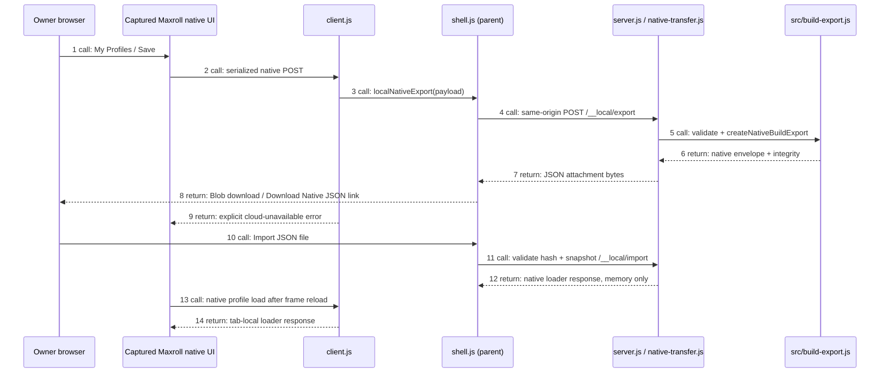

# Native JSON export/import — #173 / PR #175 scope update

The owner now requires native downloads. This supersedes earlier README/assessment statements that export was out of scope. Calculation integration and canonical schema changes remain out of scope.

## Assessment: AGREE / FIX_REQUIRED

Before: My Profiles → Save serialized the live build but the HTTP server rejected its POST. No browser download existed. The original serializer already handles the native registry, multiple profiles, equipment, affixes, aspects, tempers, sockets, skills, Paragon, glyphs and effects. Reimplementing that serializer would introduce unnecessary loss/mapping risk.

After: `client.js` intercepts **only** the native `POST /profiles/d4` transport. `shell.js` sends that payload to a same-origin local endpoint; `native-transfer.js` reuses `src/build-export.js` (`validateNativeState`, `createNativeBuildExport`, `serialize`). The server validates structure and limits JSON to 8 MiB. The parent creates a Blob download, with an explicit download link if automatic download is deferred by the browser. No calculation runtime starts. The native save operation receives an explicit cloud-unavailable error, never a fake profile ID or cloud-save success.

The existing envelope is `maxroll-native-build-export/v1`, format `MAXROLL_NATIVE_STATE`. `nativeState` contains the complete serialized state without a field whitelist or value/order normalization. Arrays, including `[null, null]`, retain their positions. Metadata outside native state carries snapshot ID, manifest SHA, displayed runtime version, provenance and SHA-256 native-state integrity. Auth/account fields from Save metadata are not copied. Unknown **native state** fields are retained; synthetic tests cover this independently of supported native UI fields.

Import accepts this envelope only for the exact snapshot/manifest and verified native-state hash. It reuses the captured profile response identity and the original UI's profile loader. The response is transient in the parent tab; the child fetch wrapper supplies it on profile load. No build is stored on F, in a cloud account, localStorage or sessionStorage. Closing/reloading the parent discards imported state. Browser downloads are the durable user-owned copy. This is not a Maxroll cloud sharing format or a promise that future versions can import it.

## Security and compatibility

- Server binds loopback; POST requires matching Origin, JSON MIME and bounded size. Missing/invalid data, tampered integrity, wrong snapshot and cross-origin requests fail closed.
- Raw builds are neither persisted nor added to diagnostics. Download errors use fixed messages rather than payload excerpts.
- Parent performs downloads; child iframe sandbox/CSP are **unchanged**, including blocked top navigation, popups, workers and external network. No `allow-downloads` was added to the third-party frame.
- Cloud login/share/save remain unavailable. Native Save returns a clear local-download/cloud-unavailable message. Transfer endpoints are stateless and do not impersonate production persistence.
- Existing canonical codec checks exact compatibility before decoding. This UI manifest has no calculation binding. Moreover, `canonical-codec-core.js` requires a socket entity ID, and `d4-build-v1.schema.json` rejects null socket entries. Native export reports `CANONICAL_EXPORT_UNSUPPORTED`; no canonical download option is offered. No empty socket is removed and no public schema/API changes are made.
- UI import validation does not invent unknown native entity IDs. A file manually edited outside the native UI may be rejected/normalized by Maxroll's own loader; the demonstrated round-trip scope is native UI-generated state from this snapshot.



## Icon finding

Runic Skullcap card uses a separate `images/webp/2679069819.webp` (120×180), `frames.979f76d2.webp` and `socket.130ea97d.webp`; tooltip uses the atlas. All are present in the frozen manifest and decode locally. Empty sockets overlap the dark helm artwork in the native layout. No replacement image, CSS redesign or additional capture was necessary for this finding.

The original independent online capture `desktop-equipment.png` has the card at x=9, y=73, width=49, height=73. A focused comparison matches the local card exactly. Deliberately hiding the artwork changes **15.04%** of card pixels (threshold 0.5%), proving the regression catches missing artwork instead of diluting it across a large screenshot. `export-check.js` restores the style immediately after this negative test; runtime code does not modify the card.

A new online reference attempt could not verify the frozen runtime fingerprints and was rejected. It is **not** used as a new golden or source of merged assets. The preserved original capture is the comparison source. `reference-ui.js` now requires an empty output directory to avoid overwriting independent evidence. Full UI completeness remains bounded by the documented captured/tested scenarios, not every possible item or class interaction.

## Use on F / Android

Install the existing provider dependencies once (`npm ci --ignore-scripts` in `providers/maxroll`), in addition to the browser-infra prerequisites. Start/status/stop CLI and SSH tunnel are unchanged; no new service is introduced.

1. Open the local URL through the SSH tunnel. Create/edit the build normally.
2. Click **Export JSON** in the local header. It opens native **My Profiles**.
3. Enter a name and click native **Save**. This invokes the native serializer but downloads locally; the cloud-unavailable message is intentional.
4. The file is `maxroll-native-build.json`. If the browser defers automatic download, tap **Download Native JSON** in the header (last exported state; export again after further edits).
5. Use **Import JSON** to select the downloaded file. Then export again to retain subsequent changes.

Chrome/Samsung Android actual download/file-opening remains Owner MAN; desktop and Pixel 7 emulation do not replace it. The interface retains Maxroll's native mobile layout; landscape/Desktop site can help reach controls.

## Local verification

```bash
node --test server.test.js ui-package.test.js native-transfer.test.js
CHROMIUM_EXECUTABLE=/absolute/chrome node --test diagnostics.test.js
node export-check.js /private/export-config.json
LOCAL_EDITOR_CONFIG=/private/serve-config.json python3 lifecycle-check.py
python3 icon-regression.py /private/original-online/desktop-equipment.png \
  /private/export-uat/desktop-card.png /private/export-uat/desktop-card-missing.png \
  --crop 9,73,49,73 --report /private/export-uat/icon-report.json
```

Export config: `url`, `chromium`, `evidenceDir` (all evidence private). The legacy `browser-check.js` environment entrypoint now runs the same actual-download checks. `verify-ui.js` still covers all eight classes/reloads; `export-check.js` asserts actual Playwright download completion, JSON file contents, same-origin enforcement, exact native Save equality and import/re-export equality. It covers a 4-profile/596-item captured build and an independently UI-created Rogue/level69/helm850/Puncture/Paragon build, including empty sockets. No Playwright snapshot interception substitutes for HTTP replay.

| Acceptance | Automated evidence / result | Manual gate |
|---|---|---|
| EXP01 | Native serializer → envelope PASS | — |
| EXP02 | Actual downloaded and parsed files, desktop/mobile emulation PASS | Android NOT_RUN |
| EXP03 | Full native registry equality, 596 items; affix/aspect/temper arrays PASS | — |
| EXP04 | Complete profile equality including Skills/Paragon/glyph/effects PASS | — |
| EXP05 | `[null,null]` unchanged; mixed sockets/order synthetic test PASS | — |
| EXP06 | Export → native UI import → export full state deep equality PASS | — |
| EXP07 | Zero external responses; attempts CSP-failed; cross-origin POST rejected PASS | — |
| EXP08 | Explicit unsupported canonical result; null rejected by existing schema PASS | Canonical export UNSUPPORTED |
| EXP09 | — | Real Android download/open JSON NOT_RUN |

CI_NOT_CHECKED. No merge/release or private snapshot/evidence upload. Exact HEAD, commands/results and live handoff PID are recorded in #173 / PR #175.
