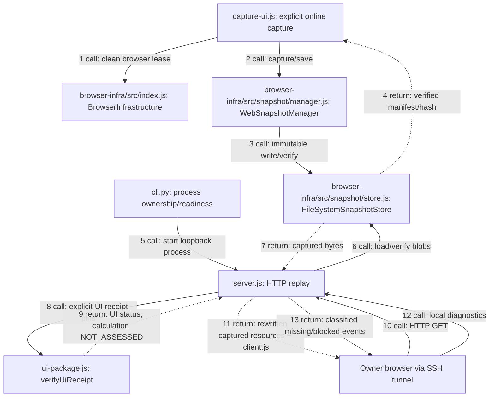

# Independent Planner UI checkpoint — #173 / PR #175

Historical UI-only checkpoint. [EXPORT.md](EXPORT.md) records the subsequent owner-authorized native download/import scope; Save/export exclusions below apply to the earlier checkpoint only.

## Assessment and decision

**AGREE / FIX_REQUIRED.** The calculation capture was sufficient for its calculation binding, but not a complete UI capture. Its 365 responses omitted item, skill and aspect atlases. The old HTTP loader also required a calculation catalog binding just to display the UI. Neither a successful calculation nor an HTTP 200 establishes UI completeness.

The minimal change extends provider tooling using the existing `BrowserInfrastructure`, `WebSnapshotManager` and `FileSystemSnapshotStore`. A separate immutable UI package has explicit manifest/coverage trust pins and a UI validation status. `server.js` retains its legacy calculation-bound load path for configs without `uiTrust`; UI configs never consult that catalog. Calculation snapshots, compatibility bindings, codec and eight Application APIs are unchanged. UI status always reports calculation `NOT_ASSESSED`.

Alternatives rejected: VNC does not run the app in the owner's browser; handwritten cards would conceal missing capture; adding a fake calculation binding would misrepresent compatibility; downloading missing assets during replay would break offline guarantees. Native frontend calculation bundles remain part of the captured web application, without connecting it to Rule Kit.

A second confirmed defect was CSS URL replay: minified `@import"..."` and stylesheet-relative resources were not all mapped. Captured Google Fonts CSS remained remote and CSP correctly blocked it. `rewriteCss` now resolves URLs against the owning stylesheet, including root paths and imports without whitespace. Five explicitly captured origins map to local paths. CSP and iframe sandbox are unchanged; external API/tracking attempts stay blocked. This evidence explains visual differences, **not the historical Android blank-frame incident**, whose original failing logs were not retained.

## Execution boundaries

Paths below are relative to this directory except the explicitly named shared infrastructure files. Solid arrows are calls; dotted arrows are returns.



No capture code runs in the HTTP server. No Chromium is launched by serving. The capture and reference commands below intentionally access online resources; replay never downloads on miss. Local POST is rejected rather than reporting a successful cloud Save.

## Private package audit and evidence

Captured package: `maxroll-ui-20261102T152518Z`, UTC `2026-11-02T15:25:53.027Z`, 1,167 responses / 79,899,023 body bytes. Source is a public Planner profile; its captured HTML provides the application entrypoint. The package contains JS/dynamic chunks, CSS, fonts, item/skill/aspect atlases, game/localization JSON and catalog-derived Paragon mask images. Browser: Chromium 156.0.8078.4; Playwright 1.64.1. Clean context, service workers blocked and cache disabled during capture.

- Manifest SHA-256: `f287586d6554c86e277be368536699ecec336872668ac2fd2f29c981e4f87762`.
- Coverage SHA-256: `b8b5364a443dbf9fc751eabaef9ff7047fd7680e003c8f3b09293b607c29406a`.
- Displayed game version: `3.2.1.73552`; frontend export SHA-256: `6fa03246c97e637c583ac17883f32652e9e49340304bdd97f1b78920fdc99d35`.
- Engine and game-data fingerprints differ from the old calculation snapshot despite the same displayed patch. Version labels alone are insufficient. Capture checks fingerprints again before saving; conflicting response bodies fail rather than merging versions.
- Raw catalog: 12,195 item records; item atlas: 7,375 image IDs. Of 7,284 distinct primary item image IDs, 27 are absent from the native atlas, including test/quest/currency records. This is not evidence that every raw catalog record is a selectable equipment item. No claim of clicking every item is made.
- Capture scenarios plus HTML/CSS/computed style/srcset inventory and Paragon catalog inventory cover lazy resources. Reference runs independently use the online application from this same capture version. Online mobile Google Fonts CSS varies by user agent, with two additional font URLs; the local captured font variant remains visually equivalent in the measured states. These variants are recorded separately, not silently treated as identical bytes.
- Auth `/users/whoami`, `/api/me`, Twitch, ads/tracking and browser touch/favicon requests are outside Planner functionality. Missing counts are classified by impact. No impacting missing resource or uncaught JavaScript error was observed in tested UI flows.

Integrity means exact manifest and blob hashes; trust means an owner-selected local manifest/coverage pin and authorization reference; UI completeness means measured scenario/visual coverage; calculation compatibility is not assessed for this package. Owner permission authorizes local capture/use, **not redistribution rights**. Snapshots, raw responses, screenshots, logs and generated validation receipts stay private outside Git and Actions. Public distribution is not authorized by this change.

## Coverage and limits

| ID | Expected / automated actual | Status / owner |
|---|---|---|
| UI01 | Immutable manifest, provenance, hashes and coverage; exact-pin and corruption rejection tests | PASS / F AUTO |
| UI02 | Ordinary HTTP replay starts without calculation catalog or Chromium | PASS / F AUTO |
| UI03 | Native equipment picker/editor/card/tooltip compared against independent online reference | PASS / F AUTO |
| UI04 | New Profile; eight class selections; level 69; Rogue Runic Skullcap item power 850 | PASS / F AUTO |
| UI05 | Eight class initial Paragon views; Rogue Puncture and adjacent Paragon node allocation | PASS / F AUTO |
| UI06 | Zero impacting missing resources across those flows; 28 visual states, desktop/mobile | PASS within measured scope / F AUTO |
| UI07 | Ordinary HTTP browser, no interception supplying resources; external attempts fail via CSP, zero external responses | PASS / F AUTO |
| UI08 | Reload, real SSH forwarding, repeated start/stop, conflict preservation; calculation regression | PASS / F AUTO |
| UI09 | New package Android render/touch/input/navigation | NOT_RUN / Owner MAN |

Visual comparison uses identical native state and inner viewport (1440×1100 desktop, 412×839 mobile), no content masks, channel difference >16 and changed-pixel fraction <=0.005. The original third-party mobile layout is retained. Eight initial class boards do not establish exhaustive testing of every class skill, every equipment variant or all endgame boards. Save/export, durable build persistence and canonical conversion remain outside this checkpoint. Reload can discard edits.

## Reproduce privately

Create capture config with `snapshotRoot`, a **new** `snapshotId`, `chromium`, private `evidenceDir` and a publicly accessible `sourceUrl`. Existing package IDs are never overwritten. Capture requires explicit permission to access that online source.

```bash
node capture-ui.js /private/capture-config.json
```

Serve config adds the following to the existing `snapshotRoot`, `snapshotId`, `manifestSha256`, `port` fields:

```json
{
  "uiTrust": {
    "schemaVersion": "maxroll-ui-trust/v1",
    "coverageSha256": "<exact SHA-256 of ui-coverage.json>",
    "validationSha256": "<optional exact SHA-256 of ui-validation.json>"
  }
}
```

Without a validation receipt the truthful UI state is `CAPTURED_UNVALIDATED`. A pinned `maxroll-ui-validation/v1` receipt may attest `AUTOMATED_VALIDATED` only after reviewing real evidence; it binds snapshot ID, manifest SHA, coverage SHA, calculation `NOT_ASSESSED` and private test evidence. It is a local attestation, not a signature or a substitute for Android manual acceptance.

```bash
python3 cli.py start --config /private/serve-config.json --ssh-target USER@LINUX_F
python3 cli.py status --config /private/serve-config.json
node --test server.test.js ui-package.test.js
CHROMIUM_EXECUTABLE=/absolute/chrome node --test diagnostics.test.js
LOCAL_EDITOR_CONFIG=/private/serve-config.json python3 lifecycle-check.py
node reference-ui.js /private/reference-config.json
node verify-ui.js /private/verify-config.json
python3 compare-visuals.py /private/online-reference /private/http-evidence
python3 cli.py stop --config /private/serve-config.json
```

Reference config uses `snapshotRoot`, `snapshotId`, `manifestSha256`, `chromium`, `referenceDir`; verify config uses `url`, `chromium`, `evidenceDir`. References access online intentionally; verify uses ordinary HTTP without Playwright replay interception. Shared regressions: `npm test` in `application` and `BROWSER_INFRA_CHROMIUM_PATH=/absolute/chrome npm test` in `browser-infra`. CI_NOT_CHECKED.
