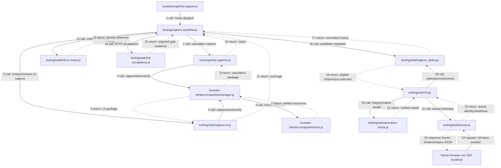

# Unified Maxroll capture and local UI selection

## Assessment and ownership

AGREE / FIX_REQUIRED. `scripts/snapshot-capture.js` already owns the npm command and preserves the persistent calculation contract from #132. It should remain an argument/dispatch boundary; `tooling/capture-workflow.js` composes the existing `MaxrollSnapshotCapturer`, `capture-ui.js`, store and acceptance runner. No new browser/capture framework is introduced. The existing build-index includes every provider src file in calculation execution identity; placing this orchestrator under tooling preserves that identity. The calculation index and its bindings remain byte-for-byte unchanged.

The signed registry in `snapshot-management/schemas/registry.schema.json` binds calculation provider/codec/schema/strategy and approval evidence. Its `selection.json` selects an approved calculation binding. A captured UI cannot satisfy that contract. Reusing it for UI activation would require false compatibility approval or a public contract change. Therefore provider-local `capture_state.py` stores capture history and the **single UI operational selection**. It never modifies the calculation registry, selection, compatibility catalog, engine or Application APIs. Legacy server config pins become generated process configuration after one-time adoption; they are no longer a second mutable UI selection.

`all` reuses one BrowserInfrastructure process with separate anonymous leases. Sharing page/cache/storage would alter the existing capture policies and risk missed response bodies. It stores separate immutable packages, compares exact runtime asset and game-data/localization URL+SHA maps plus observed version, then permits UI validation. A same patch label with different bytes fails consistency; neither member is offered as a synchronized pair. Calculation remains CAPTURED_UNVALIDATED with its original PATCH_DRIFT/PIN_MATCH_UNVALIDATED report, regardless of UI results.

Tradeoffs: comprehensive UI capture includes online reference preparation and several minutes of browser QA. Native catalog classes must exactly match the captured coverage; new/uncovered classes fail UNSUPPORTED_VERSION rather than producing a partially validated UI. A new structure may require provider tooling updates and reports UNSUPPORTED_VERSION rather than claiming compatibility. This is an explicit manual capture command, never an online background sync or CI capture. Activation has bounded downtime on the fixed port and a recovery journal; it does not promise zero downtime.

## Normal three-step workflow

From `utility/d4planner/d4planner-rulekit/providers/maxroll`:

```bash
npm run snapshot:capture -- --mode ui
d4planner-web start
```

Then open `http://127.0.0.1:6085/` through the existing SSH tunnel. No per-run snapshot ID, hash, output directory, source change or config edit is required.

Other supported modes:

```bash
npm run snapshot:capture -- --mode calculation
npm run snapshot:capture -- --mode all
# Backward compatible exact output folder, no new config required:
npm run snapshot:capture -- --output /private/snapshot-store/maxroll-YYYYMMDD
```

Omitting `--mode` means calculation. With no output, fixed private settings provide automatic naming and roots. Explicit `--mode calculation --output ...` also retains the original capture/artifact behavior. `--output` with `all` is rejected because a run has two package directories. `--config /private/settings.json` or `MAXROLL_CAPTURE_CONFIG` selects another installation's private settings.

`d4planner-web status` lists active/previous/candidate and validation statuses. `d4planner-web stop` stops only its owned service. `d4planner-web rollback` validates/probes the previous UI, switches and commits only after verification. A rolled-back candidate is excluded from automatic reselection; a new validated capture may subsequently be selected. No snapshots are deleted.

Before switching, the CLI warns that reload loses unexported tab state. The existing manifest pin in the browser rejects stale-tab transfers (409); a build from an old UI cannot silently acquire new provenance. Native export/import and cloud limitations remain as documented in COMPLETE-UI.md.

## One-time installation settings

Default file: `$XDG_CONFIG_HOME/streamops/maxroll-capture.json`, otherwise `~/.config/streamops/maxroll-capture.json`. It must be owned by the current user, mode0600. Roots must be private0700 directories outside the checkout. An example of the internal configuration shape follows; actual authorization and an accessible public planner source must be supplied during installation:

```json
{
  "schemaVersion": "maxroll-capture-config/v1",
  "sourceUrl": "https://maxroll.gg/d4/planner/<authorized-public-planner-id>",
  "stateRoot": "/private/maxroll/state",
  "uiRoot": "/private/maxroll/ui",
  "calculationRoot": "/private/maxroll/calculation",
  "chromium": "/absolute/installed/chrome",
  "web": {
    "port": 6085,
    "sshTarget": "USER@LINUX_F",
    "runtimeDir": "/private/maxroll/web.runtime"
  }
}
```

`chromium` may be omitted to reuse `discoverBrowser` (configured environment/system/installed Playwright binary). No automatic browser or asset download occurs during replay. For migration, point `web.runtimeDir` to the existing CLI runtime directory once. Its running validated server is adopted only after checking PID/start identity, command line/config, and the existing manifest/coverage/validation pins. Adoption does not restart it. A wrapper then invokes `python3 tooling/web/cli.py "$@"` with the fixed settings path/default. Legacy `cli.py --config <pinned-server-config>` remains supported.

Capture outputs live in `<uiRoot>/<runId>-ui` and `<calculationRoot>/<runId>-calculation`; private run evidence in `<stateRoot>/runs/<runId>`. IDs combine timestamp and random suffix. The store refuses overwrites. Readiness is separate from integrity and distribution authorization; nothing in this tooling grants public distribution rights.

## Metadata and transitions

`capture-state.json` is an internal `maxroll-capture-state/v1` payload in a SHA256 envelope. It contains monotonic revision, runs, packages, activeUi, previousActiveUi, history and an optional pending transition. Package records retain snapshot ID/kind/mode, run ID, capture timestamp, related snapshots, runtime/game fingerprints, manifest hash, coverage/validation hashes, immutable server pins and validation status. UI ACTIVE/PREVIOUS_ACTIVE are projections of selection pointers; they do not overwrite validation status.

Validation statuses: CAPTURED_UNVALIDATED → VALIDATING → VALIDATED, or UNSUPPORTED_VERSION/FAILED. Only a VALIDATED UI from a COMPLETE run is automatically eligible. Calculation cannot receive VALIDATED through this state boundary. A consistency-failed `all` run is never eligible, even if a package has usable bytes.

Metadata transactions use kernel `flock`, private files, temp+fsync+atomic rename+directory fsync, and digest/schema/selection checks. Locks release on process death; concurrent capture commands cannot overwrite each other's records. This checksum detects accidental corruption, not malicious edits by the same OS user; authorization still comes from owned private configuration and exact package trust pins. No registry is placed in FE/HUD/BE. The orchestrator owns SIGINT/SIGTERM/SIGHUP and disables Playwright process-exit handlers for its shared capture browser, so cancellation writes FAILED and closes the browser before returning. Child validation gates drain/close their streams before metadata cleanup.

Activation is serialized by the existing service lock:

1. Resolve eligible UI and verify full integrity/provenance/validation.
2. Check current process ownership and port; never kill an unknown listener.
3. Run the candidate on an isolated port and execute existing native UI export/import health checks on desktop/mobile.
4. Persist a transition journal before stopping the old owned process.
5. Start the candidate on the fixed loopback port; verify snapshot ID and manifest.
6. Only then commit active/previous selection. On failure, restore the old process/selection and exit nonzero.

After interruption, the next start restores the previously committed selection and reports nonzero, preserving the recovery evidence. The child server refuses to bind unless its CLI ownership record was durably written, closing the spawn-before-state orphan-listener window. No forced kill is used. A rollback that itself cannot restore a corrupted old package leaves the journal intact and fails closed rather than inventing READY.

## Validation and local acceptance

Before: capture, online reference, QA configs/hashes and activation were separate manual steps. After: the capture command generates all private pins/evidence, runs the existing gates and emits a candidate only on success. `full-acceptance.js` now has explicit `scope: ui`: all former UI/resource/visual/negative/export/offline/lifecycle gates remain required. Only the separate calculation regression phase is omitted for routine UI capture, so opening UI does not require a supported calculation snapshot. Default full acceptance is unchanged. Both scopes require clean, unchanged installed Git HEAD for reproducible validation.

`unified-acceptance.py <private-isolated-config> <new-private-output>` runs the real npm legacy/calculation/UI/all commands, starts/opens/reuses/updates/rolls back an isolated HTTP service, cancels a real capture and proves the active UI remains usable, and runs the existing component/real calculation regressions. It verifies config bytes and HEAD stayed unchanged between steps; reports CAP-01…16 as JSON and Markdown. Use a fresh stateRoot and free test port; never point fault tests at the Owner service. For final development regression only, the isolated config also includes `calculationRegression` with the already approved snapshotRoot/snapshotId/manifestSha256/sourceUrl/authorizationRef/profileId. This is not needed for routine UI capture or activation.

Unit/contract tests cover parse compatibility, unique IDs, gate rejection, same-patch fingerprint drift, concurrent/corrupt state, real Node process rollback after injected post-bind failure, interrupted promotion, stale-tab pins, occupied ports and foreign PID protection. They are not substitutes for the opt-in real capture workflow. Browser artifacts and native files remain private. Real Android is an Owner MAN gate; prior Android acceptance does not automatically prove a newly captured frontend.

## Component interaction flow

Solid edges are calls; dotted edges are returns. All source paths exist.



CI_NOT_CHECKED. No merge/release/production deployment or private snapshot publication is part of these commands.
