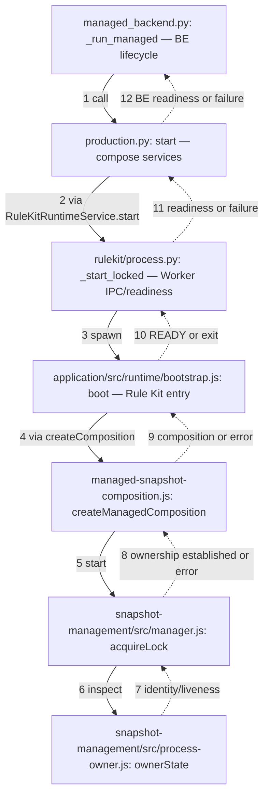

# Issue 213: Windows snapshot lease recovery and startup diagnostics

A legacy `.manager.lock` recorded only PID and random owner ID. After Windows
reused that PID for a protected process, `process.kill(pid, 0)` raised `EPERM`.
Snapshot Manager failed before Chromium startup; the BE never reached WebSocket
readiness. The structured log only recorded STARTUP_FAILED and stderr byte count.

## Change

Windows now queries process creation time through a bounded, hidden, read-only
PowerShell call using `System.Diagnostics.Process.StartTime`, with a system CIM
module fallback only when the native read fails. New leases record that identity. Matching identity remains
busy; a later creation identity proves PID reuse. For legacy leases, a process
created more than one second after the lease's last-write timestamp is treated as
a reused PID. Absent processes are also recoverable. Equal/older/unknown legacy
timestamps remain busy. Invalid identities, unavailable identity queries and query timeout
fail closed. This uses local OS timestamps; externally altered lease timestamps
or clock changes are outside automatic recovery guarantees. Do not manually edit
lease timestamps to force recovery.

Recovery retires only the lease after checking its recorded owner/PID again; it
never signals or terminates the referenced Windows process. Existing active locks
remain exclusive. POSIX liveness behavior is preserved. No snapshot, registry,
profile, calculation API or user database is reset or modified by this change.

The Windows helper uses the system PowerShell path, numeric PID validation,
non-interactive mode, four-second timeout, an 8 KiB output limit and no raw output
in public diagnostics. No service or persistent background process is added.

## Logs and Report Issue

Managed composition records bounded `startupStage` and `startupReason` values,
alongside STARTUP_FAILED. Stages distinguish Snapshot Manager, Chromium, provider
and application creation; outer bootstrap errors use COMPOSITION. Recovery emits
snapshot/RECOVERY with OWNER_PID_REUSED or OWNER_EXITED. BE startup failure now
also records STARTUP_FAILED. Existing run ID, PID, generation and timestamps bind
these records across components.

Both the Node writer and Rust report export allow only the declared enum values.
Unknown strings, error messages, paths, raw stderr, credentials and build payloads
are excluded. The report test collects the current Rule Kit log, encrypts it,
decrypts the attachment and verifies reason/stage/run/PID/generation/timestamp
survival plus private-text removal. No real GitHub issue submission is needed for
this regression.



## Local regression

- `npm test --prefix utility/d4planner/d4planner-rulekit/snapshot-management`
- `node --test utility/d4planner/d4planner-rulekit/application/tests/startup-diagnostics.test.js`
- `cargo test --manifest-path utility/d4planner/d4planner-hud/report-issue/Cargo.toml --lib`
- Run `process-owner.test.js` on Windows: legacy protected/reused PID recovery,
  active contender rejection, protected process preserved, close/reopen cleanup.
- Build and install Setup on an isolated Windows VM; exercise startup with a
  legacy reused-PID lease, restart and controlled shutdown. A clean install alone
  does not reproduce this failure. Windows A is not an automated test target.

Regenerate the existing execution index with `npm run build:compatibility` after
Rule Kit source edits. This does not create a calculation compatibility binding
or activate any snapshot. Existing trust/compatibility policy still applies.

## Windows IPC readiness regression

The snapshot BE/Worker integration tests formerly imposed a three-second READY
deadline. That was shorter than one allowed four-second Windows identity query;
recovering an existing lease can require two queries. These tests now use the
existing ten-second `LaunchSpecification` default. Production timeouts and
ownership checks are unchanged. Operation deadlines are also unchanged.

`test_snapshot_startup.py` runs a disposable real Worker with a 3.2-second delay
at the identity boundary, then executes the real identity lookup. The old test
budget rejects this startup; the production budget permits it. Separate query
failure and deadline cases require FAILED, reaped child, drained background
tasks, and no remaining lease. The injected faults are test composition code only.

Run the complete native BE suite on the isolated Windows VM, not only the
process-owner unit tests or installed smoke flow:

```text
python -m pytest -q utility/d4planner/d4planner-be/tests utility/d4planner/script/build/tests
```

Keep measured native timings separate from injected-delay evidence: passing on a
lightly loaded VM does not establish the startup latency of a hosted CI runner.

## Follow-up: identity dependency and failure evidence

The second failed Windows CI run (44516494669, HEAD b45d225) reported eight
`worker exited before READY` failures. Its output does **not** retain the child
exception, so it does not prove a CIM timeout or a particular module failure.
The unchanged failing subset also passed under the repository's CI Context on
Windows 11 with Node 22.23.4. Windows Server 2022 runner parity is not established.

Ordinary identity lookup now avoids WMI and PowerShell module auto-discovery.
Protected native reads retain a read-only fallback using the explicit system
CIM module. Native timestamps are truncated to CIM's microsecond precision so
existing recorded identities still match. The four-second query ceiling,
fail-closed behavior and process ownership policy are unchanged.

A Windows regression introduces an incompatible CIM module in an isolated
module path: the old lookup fails, the native lookup succeeds, and the returned
identity equals a real system CIM query. An injected native-read denial exercises
the real system-CIM fallback. This proves those dependency/error paths; it must
not be presented as reproduction of the unavailable hosted-runner root exception.

Query exceptions retain only a fixed reason (`TIMEOUT`, `OUTPUT_LIMIT`,
`INVALID_RESPONSE`, `QUERY_FAILED`) in their message; the existing error code is
unchanged. Synthetic snapshot IPC tests retain those allowlisted stderr reasons
in pytest's failure output. They never print arbitrary child stderr. This test
sink changes diagnostics only, not readiness deadlines or Worker behavior.
